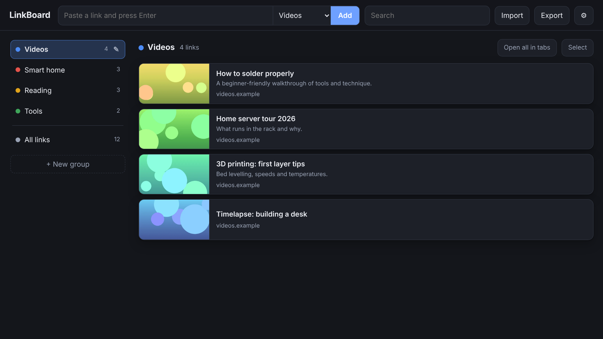
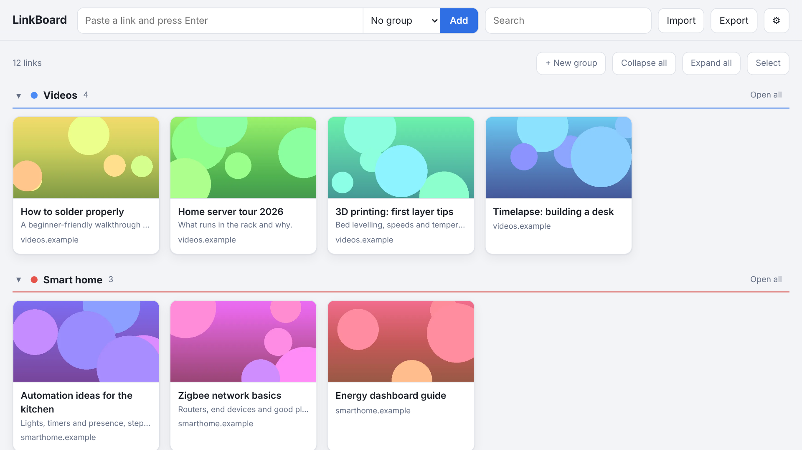

# LinkBoard

A small self-hosted home for your web links. Paste a link and it becomes a card with a thumbnail. Everything lives on one page, organised in coloured groups, a bit like browser tab groups that you can open from any device.

One container, one data folder, no external services.



<details>
<summary>The other layout: all groups as collapsible sections</summary>



</details>

## Features

- **Paste a link to save it.** Title, description and thumbnail are fetched automatically.
- **Thumbnails** come from the page's preview image (for YouTube, Vimeo and TikTok from their official embed info), then the site icon, then a letter tile. They are stored locally, so the page stays fast.
- **Groups** with colours, in your own order. Click a group to see its links; drag a group onto another to reorder.
- **Two layouts**, switchable in Settings: groups in a side column with a compact list beside it, or all groups on one page as collapsible sections with large cards.
- **Your own link order.** Drag a card inside a group to rearrange it.
- **Select several links** and move or delete them together, or drag the whole selection onto a group.
- **Open all in tabs** for a whole group at once.
- **Import in one go:** paste a list of links, or upload a bookmarks/favorites export from Edge, Chrome or Firefox. Folders become groups, duplicates are skipped.
- **Export** to a standard bookmarks file that any browser can import.
- **Backup and restore** from Settings, optionally encrypted with a password.
- **Optional login** with username and password.
- **Search** across titles, addresses and groups.
- Light and dark appearance.

## Install

You need Docker with Compose. In [Dockge](https://github.com/louislam/dockge), create a new stack and paste the compose; with plain Docker, save it as `compose.yaml` in an empty folder and run `docker compose up -d`.

```yaml
services:
  linkboard:
    image: ghcr.io/sevagjb/linkboard:latest
    container_name: linkboard
    restart: unless-stopped
    ports:
      - "8080:8080"
    volumes:
      - ./data:/data
```

Then open `http://<your-server>:8080`.

Everything LinkBoard stores (the database and the thumbnails) is in the `data` folder next to the compose file.

### First steps

1. Paste a link into the field at the top and press Enter, or use **Import** to bring in your browser bookmarks.
2. Create groups with **+ New group** and drag cards onto them.
3. Open **⚙ Settings → Login** and set a username and password. Until you do, anyone who can reach the address can see and change your links.

### Update

In Dockge press **Update**. With plain Docker:

```bash
docker compose pull && docker compose up -d
```

Your data is kept.

### Build from source instead

Replace the `image:` line with these two, and Docker builds the latest code from this repository on every deploy:

```yaml
    build: https://github.com/sevagjb/linkboard.git#main
    pull_policy: build
```

## Importing browser bookmarks

1. Export from the browser. In Edge: Favorites → `…` → **Export favorites**. In Chrome: Bookmark manager → `⋮` → **Export bookmarks**. Both save an `.html` file.
2. In LinkBoard: **Import** → choose that file → **Import**.

Each folder becomes a group. Thumbnails are fetched in the background, a few at a time, so a big import fills in over a minute or two.

You can also paste a plain list of links (one per line) into the import box, or paste several lines straight into the "add" field.

## Login

**⚙ Settings → Login** lets you set a username and password. Once it is on:

- Every page, the links, thumbnails, import, export and backup require signing in.
- "Keep me signed in" remembers a device for 30 days; **Sign out** is in Settings.
- Changing the login signs out every other device.
- After five wrong attempts, further tries from that address have to wait (15 seconds, doubling up to 5 minutes).
- The password is stored only as a salted hash.

Forgot the password? Remove the login on the server, then set a new one in Settings:

```bash
docker exec linkboard python app.py reset-login
```

## Backup and restore

**⚙ Settings → Backup** downloads a single file with everything: links, groups, colours, order and thumbnails.

- With a password the file is encrypted (AES-256-GCM, key derived from the password with scrypt) and saved as `.lbk`. A forgotten backup password cannot be recovered.
- Without a password it is a plain `.zip`.
- The login is never part of a backup.

**⚙ Settings → Restore** replaces all current links and groups with the contents of a backup file. It is all-or-nothing: a wrong password or a damaged file changes nothing.

Copying the `data` folder while the container is stopped is an equally valid full backup.

## HTTPS and reverse proxies

LinkBoard itself speaks plain HTTP. On a home network the login keeps other people out of the page, but the password is not encrypted in transit. For that, or for access from outside your network, put a reverse proxy with HTTPS in front (Nginx Proxy Manager, Traefik, Caddy …):

- Forward your hostname to `http://<your-server>:8080`. The standard forwarded headers are enough.
- Add this to the service in your compose, so LinkBoard sees the real visitor address and knows the visitor used HTTPS:

```yaml
    environment:
      - BEHIND_PROXY=1
```

Only set `BEHIND_PROXY` when a proxy really is in front; with it on, port 8080 should not be reachable directly.

## Options

Environment variables for the container:

| Variable | Default | Meaning |
| --- | --- | --- |
| `BEHIND_PROXY` | off | Set to `1` when running behind a reverse proxy (see above) |
| `FETCH_WORKERS` | `4` | How many pages are fetched at the same time |
| `DATA_DIR` | `/data` | Where the database and thumbnails are stored |

Layout and appearance are chosen in **⚙ Settings** and saved per browser, so each device can have its own.

## Good to know

- Thumbnails are the preview image a site publishes, not a screenshot. Sites without one, sites that require a login (Instagram, for example) and most local services show their icon or a letter instead. Use ↻ on a card to try again.
- Addresses typed without `http://` get `https://`, except local ones (`192.168.x.x`, `localhost`, `name.local`), which get `http://`.
- Reordering by drag and drop works inside one group, not in "All links" or in search results.
- If a link to a large site (YouTube, Instagram …) will not open with a normal click but opens with right-click → "Open in new tab", a browser extension is interfering. Try a private window to confirm.

## Roadmap

Planned work is listed in [ROADMAP.md](ROADMAP.md). Ideas and bug reports are welcome in the [issues](https://github.com/sevagjb/linkboard/issues).

## Development

```bash
pip install -r requirements.txt
DATA_DIR=./data python app.py
```

The app is a single Flask file (`app.py`) with two static pages in `pages/`, and SQLite for storage.

## License

[MIT](LICENSE)
