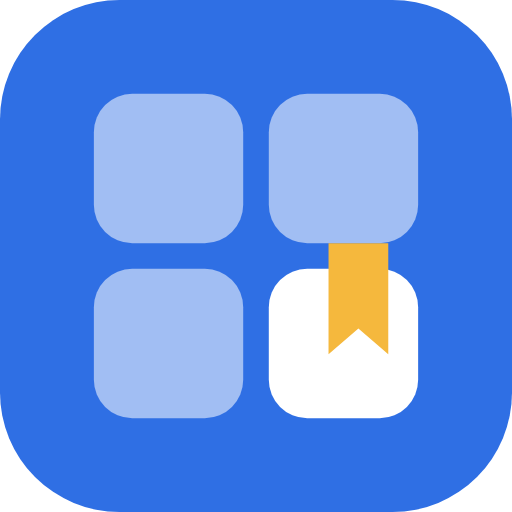

# LinkBoard

A small self-hosted home for your web links. Paste a link and it becomes a card with a thumbnail. Everything lives on one page, organised in coloured groups, a bit like browser tab groups that you can open from any device.

One container, one data folder, no external services.


<details>
<summary>The other layout: all groups as collapsible sections</summary>


</details>

## Features

- **Paste a link to save it.** Title, description and thumbnail are fetched automatically.
- **Thumbnails** come from the page's preview image (for YouTube, Vimeo and TikTok from their official embed info), then the site icon, then a letter tile. They are stored locally, so the page stays fast.
- **Groups** with colours, in your own order. Click a group to see its links; drag a group onto another to reorder.
- **Two layouts**, switchable in Settings: groups in a side column with a compact list beside it, or all groups on one page as collapsible sections with large cards.
- **Your own link order.** Drag a card inside a group to rearrange it.
- **Select several links** and move or delete them together, or drag the whole selection onto a group.
- **Favourites:** star a link to keep it at the top of its group and in a Favourites list.
- **Notes** on a link, shown on the card and included in search.
- **Sort** a group by your own order, newest, oldest, name or site.
- **Recently added** and **Recently opened** lists.
- **Save from anywhere:** a browser button, the phone's Share menu (when installed as an app over HTTPS), or an API key for scripts.
- **Broken-link check:** once a week (or on demand) LinkBoard checks every link and lists the ones that no longer work.
- **Your own picture** for a card: upload or paste an image when a site offers none.
- **Refresh** titles and pictures for one link, a selection, a whole group or everything.
- **Share** a link from its card: the phone's share sheet where there is one, otherwise the address is copied.
- **Open all in tabs** for a whole group at once.
- **Import in one go:** paste a list of links, or upload a bookmarks/favorites export from Edge, Chrome or Firefox. Folders become groups, duplicates are skipped.
- **Export** to a standard bookmarks file that any browser can import.
- **Backup and restore** from Settings, optionally encrypted with a password.
- **Accounts for everyone in the house:** each person has their own links, groups, settings, API key and backups. The first account is the admin and adds the others.
- **Never open by accident:** a new installation asks for the first account, protected by a one-time setup code from the container log.
- **Home Assistant add-on:** LinkBoard in the HA sidebar, signed in with your Home Assistant account.
- **Card options per account:** picture size, open links in a new or the same tab, and the default group for new links.
- **Daily backup** of the whole installation in the data folder, the last 7 kept.
- **Search** across titles, addresses and groups.
- Light and dark appearance.

## Install

LinkBoard runs in Docker (below) or as a [Home Assistant add-on](#home-assistant-add-on).

You need Docker with Compose. In [Dockge](https://github.com/louislam/dockge), create a new stack and paste the compose; with plain Docker, save it as `compose.yaml` in an empty folder and run `docker compose up -d`.

```yaml
services:
  linkboard:
    image: ghcr.io/sevagjb/linkboard:latest
    container_name: linkboard
    restart: unless-stopped
    ports:
      - "8080:8080"
    volumes:
      - ./data:/data
```

Then open `http://<your-server>:8080`.

Everything LinkBoard stores (the database and the thumbnails) is in the `data` folder next to the compose file.

### First steps

1. Create the first account on the welcome screen. It is the admin. The screen asks for a **setup code**, printed in the container log: in Dockge open the stack's log, with plain Docker run `docker logs linkboard`. (`docker exec linkboard python app.py setup-code` shows it again.) The code only exists until the first account is made; it stops anyone else on your network from claiming a fresh installation before you do.
2. Paste a link into the field at the top and press Enter, or use **Import** to bring in your browser bookmarks.
3. Create groups with **+ New group** and drag cards onto them.
4. To give someone else their own LinkBoard, add them in **⚙ Settings → People**.

### Update

In Dockge press **Update**. With plain Docker:

```bash
docker compose pull && docker compose up -d
```

Your data is kept.

Image tags: `latest` is the newest **release** and is what the compose above uses. `1.1.0` (or `1.1`) stays on one release. `edge` follows every change on `main` before it is released; use it only to try out what is coming.

**Upgrading from 1.0:** the database is upgraded automatically on the first start (make a backup first, to be safe). If you had a login, it becomes the admin account with all your links and your API key, and every device has to sign in once more. If you had no login, LinkBoard asks you to create an account and gives it all existing links.

## Home Assistant add-on

LinkBoard also runs as a Home Assistant add-on, with its own panel in the sidebar. It needs Home Assistant OS or a Supervised installation (with HA Container or Core, use Docker as above).

[](https://my.home-assistant.io/redirect/supervisor_add_addon_repository/?repository_url=https%3A%2F%2Fgithub.com%2Fsevagjb%2Flinkboard)

Or by hand: **Settings → Add-ons → Add-on store → ⋮ → Repositories**, add `https://github.com/sevagjb/linkboard`, then install **LinkBoard** and turn on **Show in sidebar**.

- **No second login:** Home Assistant tells LinkBoard who is signed in. Every HA user gets their own LinkBoard account on first visit; the first one and all HA admins are LinkBoard admins.
- **Backups:** everything is in the add-on's data folder, so Home Assistant backups include LinkBoard.
- **Browser button, phone app, API key:** these need a fixed address. Enter a port under the add-on's **Configuration → Network**, set a password in LinkBoard's **⚙ Settings → Your account**, and use `http://<your-home-assistant>:<port>`. Leave the port empty to reach LinkBoard only through Home Assistant.
- **Moving from Docker:** make a backup in your Docker LinkBoard and restore it in the add-on (each person their own).

The add-on uses the same image as the Docker install. Details: [homeassistant-addon/DOCS.md](homeassistant-addon/DOCS.md).

### Build from source instead

Replace the `image:` line with these two, and Docker builds the latest code from this repository on every deploy:

```yaml
    build: https://github.com/sevagjb/linkboard.git#main
    pull_policy: build
```

## Importing browser bookmarks

1. Export from the browser. In Edge: Favorites → `…` → **Export favorites**. In Chrome: Bookmark manager → `⋮` → **Export bookmarks**. Both save an `.html` file.
2. In LinkBoard: **Import** → choose that file → **Import**.

Each folder becomes a group. Thumbnails are fetched in the background, a few at a time, so a big import fills in over a minute or two.

You can also paste a plain list of links (one per line) into the import box, or paste several lines straight into the "add" field.

## Save from anywhere

**Browser button.** In **⚙ Settings → Save from anywhere**, drag **🔖 Save to LinkBoard** to your favorites bar. Clicking it on any page opens a small window where you pick the group, add an optional note and save. You need to be signed in to LinkBoard in that browser.

**Phone.** When LinkBoard runs on HTTPS, open it in the phone's browser and choose "Install app" or "Add to Home screen". On Android it then appears in the Share menu of other apps, so you can send a page or video straight to a group. iOS installs the app but does not offer web apps in its Share menu; use the API key with a Shortcut there.

**API key.** Create one in the same Settings section. Every account has its own key; links sent with it go to that account. It is shown once, and it can only add links and read group names:

```bash
curl -X POST https://linkboard.example.com/api/links \
  -H "Authorization: Bearer lb_your_key" -H "Content-Type: application/json" \
  -d '{"url": "https://example.com/article", "group_id": 3, "note": "read later"}'
```

`title`, `note` and the group are optional. The group can be given by name (`"group": "Videos"`, created if it does not exist yet) or by id (`group_id`); `GET /api/groups` with the same header lists the groups and their ids.

## Accounts and login

Every page, link, thumbnail, import, export and backup requires signing in. There is no open mode: a new installation shows a welcome screen that creates the first account, which is the admin.

- **⚙ Settings → Your account:** change your username or password (needs the current password). A new password signs out your other devices.
- **⚙ Settings → People** (admin only): add people, give them a new password, make them admin or remove them (with all their links). There is no public sign-up page; only an admin adds accounts.
- Links are private per account. The admin manages accounts but cannot see anyone else's links.
- Layout, appearance and sort order are saved with the account, so they are the same on every device.
- "Keep me signed in" remembers a device for 30 days; **Sign out** is in Settings.
- After five wrong attempts, further tries from that address have to wait (15 seconds, doubling up to 5 minutes).
- Passwords are stored only as salted hashes.

Forgot a password? This gives the first admin (or the account you name) a new random password and prints it:

```bash
docker exec linkboard python app.py reset-login
docker exec linkboard python app.py reset-login bob
```

## Backup and restore

**⚙ Settings → Backup** downloads a single file with all *your* links, groups, colours, order and thumbnails. Each person makes their own backup.

- With a password the file is encrypted (AES-256-GCM, key derived from the password with scrypt) and saved as `.lbk`. A forgotten backup password cannot be recovered.
- Without a password it is a plain `.zip`.
- Accounts, passwords and API keys are never part of a backup.

**⚙ Settings → Restore** replaces all your links and groups with the contents of a backup file; other people's links are not touched. Backups from LinkBoard 1.0 work too. It is all-or-nothing: a wrong password or a damaged file changes nothing.

For the whole installation (all accounts), LinkBoard keeps a **daily backup** in `data/backups/`, the last 7 days (the admin can switch it off under **⚙ Settings → Installation**). It holds the database with every account and the pictures people uploaded themselves; fetched thumbnails are left out to keep it small and come back with ↻. To restore one: stop LinkBoard, unzip it into the `data` folder (replacing `linkboard.db`), start it again. Copying the whole `data` folder while the container is stopped works too.

## Broken links

LinkBoard checks all links once a week and lists the ones that no longer work under **Broken links** in the left column; each also gets a "Broken" label on its card. **⚙ Settings → Link check** has a **Check now** button for your own links; the admin can switch the weekly check off under **Installation**.

A link counts as broken when its address cannot be reached on two tries, or the site answers that the page does not exist (404 or 410). Sign-in walls, bot blocks and temporary server errors are not counted, so a link is not flagged just because a site is picky. The label disappears when a later check or a refresh succeeds.

## Local addresses and safety

LinkBoard fetches pages to get titles and pictures, and the address of a picture comes from the page itself. To stop a page (or another account) from making LinkBoard look inside your network, it never fetches loopback, link-local or cloud-metadata addresses, and by default no private network addresses either (`192.168.x.x`, `10.x.x.x`, `nas.local` …). Redirects are checked hop by hop, and so is the address actually connected to.

You can still save local links; they show their address and a letter tile. If you want titles and pictures for them, and you trust everyone who has an account, the admin can turn on **⚙ Settings → Installation → Fetch titles and pictures for local network addresses**. The link check skips local addresses while this is off, so they are never reported as broken.

## HTTPS and reverse proxies

LinkBoard itself speaks plain HTTP. On a home network the login keeps other people out of the page, but the password is not encrypted in transit. For that, or for access from outside your network, put a reverse proxy with HTTPS in front (Nginx Proxy Manager, Traefik, Caddy …) and forward your hostname to `http://<your-server>:8080`.

Nothing needs to be configured in LinkBoard for this. The same compose file works for the local address, the HTTPS address, or both at once: LinkBoard reads the standard forwarded headers a proxy sends, gives HTTPS visitors an HTTPS-only login cookie, and limits wrong-password attempts per visitor either way.

## Options

Environment variables for the container:

| Variable | Default | Meaning |
| --- | --- | --- |
| `FETCH_WORKERS` | `4` | How many pages are fetched at the same time |
| `DATA_DIR` | `/data` | Where the database and thumbnails are stored |

Layout, appearance, sort order and the card options (picture size, open in a new or the same tab, default group for new links) are chosen in **⚙ Settings** and saved with your account.

## Good to know

- Thumbnails are the preview image a site publishes, not a screenshot. Sites without one, sites that require a login (Instagram, for example) and local services (see above) show their icon or a letter instead. Use ↻ on a card to try again.
- Addresses typed without `http://` get `https://`, except local ones (`192.168.x.x`, `localhost`, `name.local`), which get `http://`.
- Reordering by drag and drop works inside one group, not in "All links" or in search results.
- If a link to a large site (YouTube, Instagram …) will not open with a normal click but opens with right-click → "Open in new tab", a browser extension is interfering. Try a private window to confirm.

## Roadmap

Planned work is listed in [ROADMAP.md](ROADMAP.md). Ideas and bug reports are welcome in the [issues](https://github.com/sevagjb/linkboard/issues).

## Development

```bash
pip install -r requirements.txt
DATA_DIR=./data python app.py
pip install pytest pyyaml && pytest -q    # tests: upgrade, accounts kept apart, address checks, add-on sign-in
```

The app is a single Flask file (`app.py`) with a few static pages in `pages/`, and SQLite for storage. Changes per version are in [CHANGELOG.md](CHANGELOG.md).

## License

[MIT](LICENSE)
