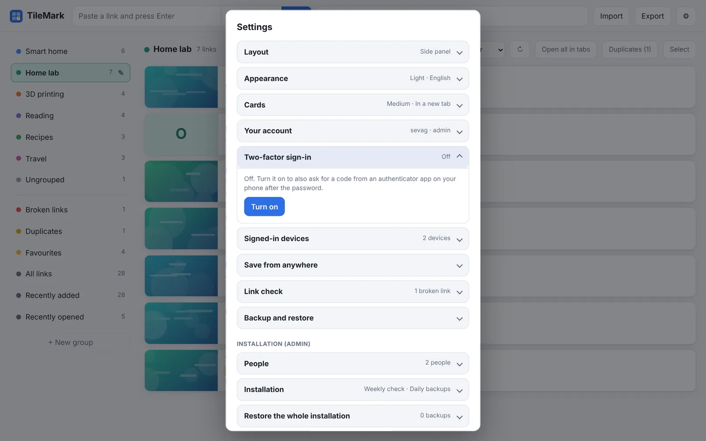

# Accounts and security

TileMark is made for a household: everyone gets their own private links, and nothing is reachable without signing in.

## Accounts

- **Every page needs signing in.** There is no open mode and no public sign-up page.
- The **first account** is made on the welcome screen (protected by the setup code from the container log; see [Getting started](getting-started.md#create-the-first-account)). It is the **admin**.
- The admin adds everyone else. Each person has their **own links, groups, settings, API key and backups**.
- **Links are private.** The admin manages accounts, but can't see anyone else's links.
- Layout, appearance, language and sort order are saved **with the account**, so every device looks the same.

### Adding people (admin)

In **⚙ Settings → People**:

1. Enter a **username** and their **first password** (at least 8 characters). Tick **Also an admin** if they should manage TileMark too.
2. Press **Add person**, and tell them their username and password. They can change both in **Your account**.

For each person, the list shows how many links they have and offers:

| Button | What it does |
| --- | --- |
| **New password** | Sets a new password for them and signs them out everywhere. |
| **Make admin / Remove admin** | Gives or takes admin rights. There is always at least one admin. |
| **Turn off 2FA** | For someone who lost their phone (only shown when they use it). |
| **Remove** | Deletes the account with **all its links, groups and pictures**. Can't be undone. |

In the [Home Assistant app](home-assistant-add-on.md), accounts are made automatically for every Home Assistant user who opens TileMark.

## Your account

**⚙ Settings → Your account** changes your **username** or **password**. Saving needs your **current password**. A new password signs you out on your other devices.

**Sign out** is at the bottom of Settings, whichever card is open.

"**Keep me signed in on this device for 30 days**" on the sign-in page remembers the device. Without it, you're signed out when the browser closes.

## Two-factor sign-in



With two-factor sign-in, TileMark asks for a **code from an app on your phone** after your password. Someone who learns your password still can't get in. It is optional, per account.

**Turning it on:**

1. **⚙ Settings → Two-factor sign-in → Turn on**.
2. Scan the **QR code** with an authenticator app: Google Authenticator, Microsoft Authenticator, 1Password, Bitwarden, Aegis, or any other. Can't scan? Type the key shown under it.
3. Enter the **6-digit code** the app shows and press **Confirm and turn on**.
4. You get **ten recovery codes**. **Download** them or write them down, and keep them somewhere safe. Each one signs you in once if your phone isn't at hand.

**Signing in** then takes your password and the current code from the app (or one recovery code).

- **New recovery codes** replaces your codes, for example when you've used most of them.
- **Turn off** switches two-factor sign-in off again.
- Both ask for your current password first.
- **Lost your phone?** Sign in with a recovery code, then turn it off and on again with your new phone. No recovery codes left? Ask an admin: **People → Turn off 2FA**.

Inside the Home Assistant sidebar no code is asked: Home Assistant's own sign-in protects it there.

## Signed-in devices

**⚙ Settings → Signed-in devices** lists every browser signed in to your account, with the browser and system, its address, and when it was last active. **This device** is marked.

- **Sign out** next to a device ends that session.
- **Sign out all other devices** ends all of them except the one you're using.

Use it after signing in on someone else's computer, or if you think someone knows your password (and change it too).

## Forgot your password?

- **Another admin** can set a new one: **People → New password**.
- **The only admin?** On the server, run:

  ```bash
  docker exec tilemark python app.py reset-login          # the first admin
  docker exec tilemark python app.py reset-login lena     # a specific account
  ```

  It prints a new random password, turns off that account's two-factor sign-in and signs out its devices. Sign in with it and choose a new password in **Your account**.

  With [encrypted backups](backups.md#encrypting-the-daily-backups-admin), a reset password doesn't open them straight away: access comes back when another admin signs in, or with the recovery key.

## Protection against guessing

After **five wrong passwords**, further attempts from that address have to wait: 15 seconds at first, doubling up to 5 minutes. Passwords are stored only as salted hashes, never as plain text.

## Local addresses

To show a picture, TileMark visits the page you save, and the page itself tells TileMark where its picture is. A cleverly made page (or another account) could try to make TileMark look **inside your network**: your router, your NAS, Home Assistant. TileMark prevents this:

- It **never** visits its own machine, link-local addresses or cloud metadata addresses.
- By default it doesn't visit **private network addresses** either (`192.168.x.x`, `10.x.x.x`, `nas.local` …).
- Every redirect is checked, and so is the address it actually connects to.

You can still **save** local links: they show their address and a letter tile instead of a picture.

If you want titles and pictures for local pages too, and you **trust everyone who has an account**, the admin can turn on **⚙ Settings → Installation → Fetch titles and pictures for local network addresses**. Then use **↻** on existing local links to fetch them.

## HTTPS

TileMark itself speaks plain HTTP. At home the sign-in keeps others out, but your password travels unencrypted over your network. Put a reverse proxy with HTTPS in front for access from outside, or for full protection; see [Getting started](getting-started.md#reaching-tilemark-from-outside-with-https). TileMark gives HTTPS visitors a secure, HTTPS-only sign-in cookie automatically.
