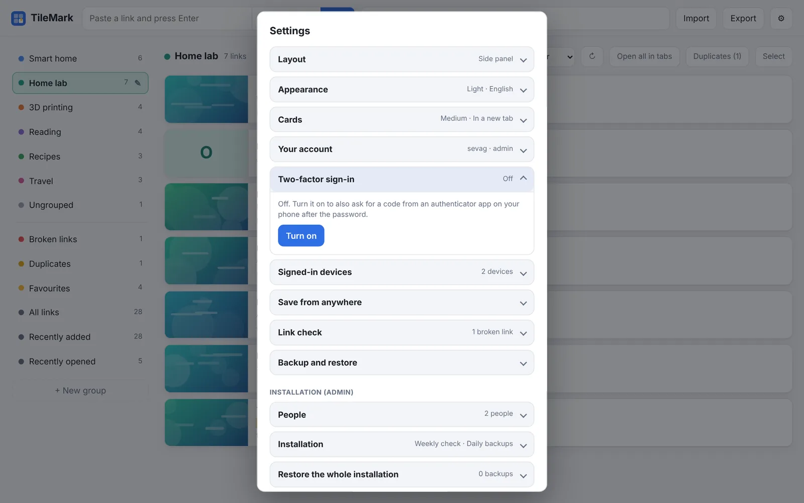

# Accounts and security

TileMark is made for a household: everyone gets their own private links, and nothing is reachable without signing in.

## Accounts

- **Every page needs signing in.** There is no open mode and no public sign-up page.
- The **first account** is made on the welcome screen (protected by the setup code from the container log; see [Getting started](getting-started.md#create-the-first-account)). It is the **admin**.
- The admin adds everyone else. Each person has their **own links, groups, settings, API key and backups**.
- **Links are private per person.** Other people never see your links, and TileMark has no screen where an admin can browse them. An admin is still trusted with a lot, though; see [What an admin can do](#what-an-admin-can-do).
- Layout, appearance, language and sort order are saved **with the account**, so every device looks the same.

### Adding people (admin)

In **⚙ Settings → People**:

1. Enter a **username** and their **first password** (at least 8 characters). Tick **Also an admin** if they should manage TileMark too.
2. Press **Add person**, and tell them their username and password. They can change both in **Your account**.

For each person, the list shows how many links they have and offers:

| Button | What it does |
| --- | --- |
| **New password** | Sets a new password for them and signs them out everywhere. |
| **Make admin / Remove admin** | Gives or takes admin rights. There is always at least one admin. |
| **Turn off 2FA** | For someone who lost their phone (only shown when they use it). |
| **Remove** | Deletes the account with **all its links, groups and pictures**. Can't be undone. |

In the [Home Assistant app](home-assistant-add-on.md), accounts are made automatically for every Home Assistant user who opens TileMark.

### What an admin can do

TileMark keeps everyone's links apart, but it is not a safe against the admin, who runs the installation. Give admin rights only to people you would trust with everyone's links:

- An admin can **set a new password** for any account (**People → New password**) and sign in with it, and can **turn off** someone's two-factor sign-in. The person notices: their old password stops working and they are signed out everywhere.
- The **daily backups of the whole installation** hold everyone's links. An admin can download them, and opens encrypted ones with their own password or the recovery key.
- Whoever can reach the **server or the `data` folder** can read the database. In the Home Assistant app, every Home Assistant administrator is a TileMark admin too.

## Your account

**⚙ Settings → Your account** changes your **username** or **password**. Saving needs your **current password**. A new password signs you out on your other devices.

**Delete all my links**, in the same card, empties your library for a fresh start: all your links, groups and pictures are deleted. Your account, settings and passkeys stay, and other people's links aren't touched. It asks you to confirm and for your current password, and it can't be undone, so press **Download backup first** if you might want them back.

**Sign out** is at the bottom of Settings, whichever card is open.

"**Keep me signed in on this device for 30 days**" on the sign-in page remembers the device. Without it, you're signed out when the browser closes.

## Two-factor sign-in



With two-factor sign-in, TileMark asks for a **code from an app on your phone** after your password. Someone who learns your password still can't get in. It is optional, per account.

**Turning it on:**

1. **⚙ Settings → Two-factor sign-in → Turn on**.
2. Scan the **QR code** with an authenticator app: Google Authenticator, Microsoft Authenticator, 1Password, Bitwarden, Aegis, or any other. Can't scan? Type the key shown under it.
3. Enter the **6-digit code** the app shows and press **Confirm and turn on**.
4. You get **ten recovery codes**. **Download** them or write them down, and keep them somewhere safe. Each one signs you in once if your phone isn't at hand.

**Signing in** then takes your password and the current code from the app (or one recovery code).

- **New recovery codes** replaces your codes, for example when you've used most of them.
- **Turn off** switches two-factor sign-in off again.
- Both ask for your current password first.
- **Lost your phone?** Sign in with a recovery code, then turn it off and on again with your new phone. No recovery codes left? Ask an admin: **People → Turn off 2FA**.

Inside the Home Assistant sidebar no code is asked: Home Assistant's own sign-in protects it there.

## Passkeys

A passkey lets you sign in with your **phone, computer or security key** instead of typing your password. The device's own unlock (face, fingerprint or PIN) proves it's you, so a passkey counts as two-factor sign-in on its own: no authenticator code is asked after it. Your password keeps working too.

**Adding one:**

1. Open TileMark on its **HTTPS address** (see [Where passkeys work](#where-passkeys-work)).
2. **⚙ Settings → Passkeys → Add a passkey**, and enter your current password.
3. Your browser or phone asks how to save the passkey (iCloud Keychain, Google Password Manager, Windows Hello, 1Password, a security key …). Confirm with your face, fingerprint or PIN.
4. Give it a name you'll recognise, such as "iPhone" or "Work laptop".

**Signing in:** on the sign-in page, press **🔑 Sign in with a passkey** and choose it. No username is needed.

In the card, each passkey shows when it was added and last used. **Rename** changes its name; **Remove** stops it working for TileMark (delete it on the device too if you no longer want it there). A passkey saved in iCloud Keychain or Google Password Manager is available on your other devices with the same account as well.

### Where passkeys work

Browsers only allow passkeys on an **HTTPS address with a name**, such as `https://links.example.org`, behind your [reverse proxy](getting-started.md#reaching-tilemark-from-outside-with-https). They **don't work** on an IP address (`http://192.168.1.10:8080`) or on plain `http`; there, the button isn't shown and Settings explains where to go instead.

A passkey belongs to the exact address it was made on. If you reach TileMark through two names, add a passkey on each; if you change the name, add new ones. Inside the Home Assistant sidebar passkeys aren't used, because Home Assistant has signed you in already.

## Signed-in devices

**⚙ Settings → Signed-in devices** lists every browser signed in to your account, with the browser and system, its address, and when it was last active. **This device** is marked.

- **Sign out** next to a device ends that session.
- **Sign out all other devices** ends all of them except the one you're using.

Use it after signing in on someone else's computer, or if you think someone knows your password (and change it too).

## Forgot your password?

- **Another admin** can set a new one: **People → New password**.
- **The only admin?** On the server, run:

  ```bash
  docker exec tilemark python app.py reset-login          # the first admin
  docker exec tilemark python app.py reset-login lena     # a specific account
  ```

  It prints a new random password, turns off that account's two-factor sign-in and signs out its devices. Sign in with it and choose a new password in **Your account**.

  With [encrypted backups](backups.md#encrypting-the-daily-backups-admin), a reset password doesn't open them straight away: access comes back when another admin signs in, or with the recovery key.

## Resetting TileMark (admin)

**⚙ Settings → Reset TileMark**, the last card, deletes **everything**: every account with all its links, groups and pictures, and all settings. TileMark starts again as if just installed, and its device disappears from Home Assistant. Use it to hand over a server, or to start completely fresh.

1. Want to keep your own links? Press **Download my backup first**.
2. Type **RESET** to confirm, and enter your **password** (and your two-factor code, if that's on). Inside the Home Assistant sidebar no password is asked.
3. Press **Reset TileMark** and confirm once more.

Afterwards the welcome screen asks for a **new setup code** from the container log; in the Home Assistant app, the first person to open TileMark from the sidebar becomes the admin.

A **copy of the whole installation** is kept in the data folder first, listed as **Before reset** under [Restore the whole installation](backups.md#restoring-the-whole-installation-admin). Restoring it brings everything back. Tick **Also delete every backup in the data folder** for a completely clean start: then no copy is kept and the daily backups are deleted too.

Only removing your own links? Use [Delete all my links](#your-account) instead.

## Protection against guessing

- After **five wrong passwords**, further attempts from that address have to wait: 15 seconds at first, doubling up to 5 minutes.
- One address can make at most **20 wrong attempts a minute**.
- One account accepts at most **10 wrong passwords, two-factor codes or passkey attempts in 15 minutes**, wherever they come from, so guessing can't be spread over many addresses.

**Your own devices are never locked out by someone else.** A browser that has signed in to your account before is exempt from the second and third rule for that account. This matters behind a reverse proxy, where every visitor seems to come from the proxy's address: a stranger's wrong attempts can make a new device wait, but not the phone or computer you always use.

Passwords are stored only as salted hashes, never as plain text. The list of signed-in devices is stored as hashes too, so a copy of the database can't be turned into a sign-in.

## Requests from other websites

Only TileMark's own pages can change anything in TileMark. When another website (also another app on the same server, or on the same domain) tries to make your browser send TileMark a change, TileMark refuses it. Apps without a browser, such as a Shortcut with an [API key](save-from-anywhere.md#api-key), are not affected.

TileMark's pages also tell the browser to:

- **run only TileMark's own code** (a Content-Security-Policy), so a strange title or a planted backup can never run a script in TileMark;
- **show TileMark in a frame only on its own address**, so another site can't hide it under its own buttons. The Home Assistant sidebar counts as TileMark's own address. To show TileMark in a frame on another address on purpose, for example in a Webpage card on a Home Assistant dashboard, see the `FRAME_ANCESTORS` [container option](getting-started.md#container-options);
- **read every file only as what it is** (`nosniff`), and send no address of TileMark's pages to the sites you open.

## Uploads

So that one person can't overload the server with a huge file:

| Upload | At most |
| --- | --- |
| A picture for a card | 20 MB |
| An import (bookmarks file, list or TileMark file) | 100 MB |
| A backup to restore | 500 MB |

Only one import or restore larger than 25 MB is handled at a time; a second one meanwhile is asked to try again in a moment.

Pictures, fetched or uploaded, are only opened as the formats websites use: **JPEG, PNG, WebP, GIF, ICO and AVIF**. Other formats are refused.

## Container user

The Docker image runs TileMark as a normal user (`tilemark`, user id 1000), not as root. When the container starts, it gives the `data` folder to that user and then drops all root rights. Updating from an older version needs nothing: the first start takes care of the folder. The [container options](getting-started.md#container-options) explain how to choose another user id.

## Local addresses

To show a picture, TileMark visits the page you save, and the page itself tells TileMark where its picture is. A cleverly made page (or another account) could try to make TileMark look **inside your network**: your router, your NAS, Home Assistant. TileMark prevents this:

- It **never** visits its own machine, link-local addresses or cloud metadata addresses.
- By default it doesn't visit **private network addresses** either (`192.168.x.x`, `10.x.x.x`, `nas.local` …).
- Every redirect is checked, and so is the address it actually connects to.
- IPv6 addresses that stand for an IPv4 address (NAT64 `64:ff9b::…` and 6to4 `2002:…`) are judged by that IPv4 address. So on an IPv6-only network with NAT64, ordinary sites still get their pictures, and a trick like `64:ff9b::127.0.0.1` is still refused.

You can still **save** local links: they show their address and a letter tile instead of a picture.

If you want titles and pictures for local pages too, and you **trust everyone who has an account**, the admin can turn on **⚙ Settings → Installation → Fetch titles and pictures for local network addresses**. Then use **↻** on existing local links to fetch them.

## HTTPS

TileMark itself speaks plain HTTP. At home the sign-in keeps others out, but your password travels unencrypted over your network. Put a reverse proxy with HTTPS in front for access from outside, or for full protection; see [Getting started](getting-started.md#reaching-tilemark-from-outside-with-https). TileMark gives HTTPS visitors a secure, HTTPS-only sign-in cookie automatically.
