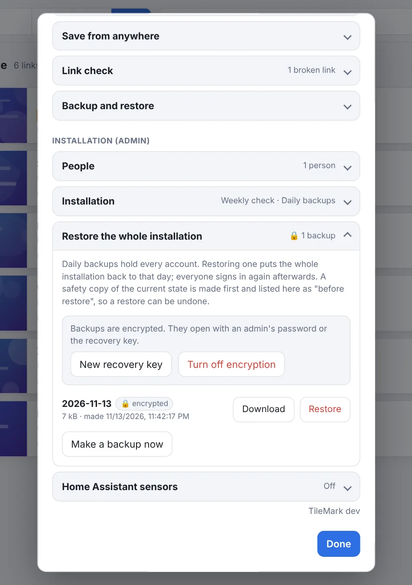

# Backups

TileMark has two kinds of backup. Use both, and your links are safe from a broken disk, a mistake or a bad update. Both can be **encrypted without an extra password to remember**: your login password is the key.

| | Your own backup | Daily backups of the installation |
| --- | --- | --- |
| **Holds** | Your links, groups, order, notes and pictures | Every account, with all links and settings |
| **Made by** | You, when you press **Download backup** | TileMark, automatically every day |
| **Stored** | Wherever you save the download | The `data/backups` folder on the server |
| **Encrypted** | Yes, with your login password (by default) | When an admin turns it on |
| **Opens with** | Your login password | An admin's password, or the recovery key |
| **Restored by** | You, in **Backup and restore** | An admin, in **Restore the whole installation** |

## Your own backup

**⚙ Settings → Backup and restore → Download backup**

The file is **encrypted with your login password**: only that password opens it. You don't have to type anything to make it. If you change your password later, both the old and the new password keep opening backups you made before.

> Accounts made before TileMark 2.4 are asked for their password **once**, the first time, to set this up.

Under **More options** you can choose differently:

| Option | When to use it |
| --- | --- |
| **A different password instead** | To give the file to someone, or to keep a password that has nothing to do with your login. A forgotten backup password can't be recovered. |
| **No encryption** | A plain `.zip` file that anyone can open. Only if you really need that. |

In the [Home Assistant app](home-assistant-add-on.md), accounts made by Home Assistant have no TileMark password until you set one in **Your account**. Until then, use **A different password** to encrypt your backup.

A backup holds your links, groups, colours, order, notes, favourites and pictures. Accounts, passwords and API keys are never part of it.

### Restoring your own backup

1. In the same section, under **Restore**, choose the backup file.
2. Enter the password: your login password (from the day of the backup, or today's), or the backup's own password if you chose one.
3. Press **Restore from backup** and confirm.

This **replaces all your current links and groups** with those in the file. Other people's links are not touched, and neither is your account. It is all or nothing: a wrong password or a damaged file changes nothing.

You can restore into another TileMark or another account, as long as you know the password. Older files work too, including unencrypted ones and backups from LinkBoard (TileMark's earlier name).

> Just want your links in another format? [Export](import-export.md#export) makes a readable TileMark or bookmarks file instead.

## Daily backups of the whole installation

Every day TileMark copies the whole installation (every account with its links and settings, and the pictures people uploaded themselves) into `data/backups/`. The **last 7** are kept. Fetched pictures are left out to keep the files small; they come back by themselves.

The admin can switch this off in **⚙ Settings → Installation → Keep a daily backup of the whole installation**. In the Home Assistant app it is off by default, because Home Assistant's own backups already include TileMark.

> **Copy them elsewhere.** A backup on the same disk doesn't survive a broken disk. Copy the `data/backups` folder to a NAS, another computer or cloud storage now and then, or let your server's backup tool include it. With encryption on, those copies are safe to store anywhere.

### Encrypting the daily backups (admin)

Without encryption, anyone who gets a copy of a daily backup can read every account's links. Turn encryption on in **⚙ Settings → Restore the whole installation → Turn on encryption**:

1. TileMark tells you exactly which existing backups will be **deleted**, because they are not encrypted, with their number and dates. Confirm to continue.
2. Enter your password.
3. TileMark makes a first encrypted backup straight away, then deletes the old unencrypted ones.
4. It shows a **recovery key** once, like `U3BW4-9VC7G-5PC8U-2YLGY-M4LM5`. **Download** it or write it down, keep it somewhere safe (a password manager, or printed), and press **I have saved it**.

From then on, every daily backup and every safety copy is encrypted (files ending in `.tmk`, marked 🔒 in the list).

**Who can open them?**

- **Every admin, with their own password.** Nobody has to share a password.
- **The recovery key**, when no admin password works: on a brand-new server, or when every admin forgot their password.

Each backup file carries what it needs to be opened, so it also works on a completely new installation. There you use the password an admin had **on the day of that backup**, or the recovery key.

**Changing passwords:**

| What happens | Effect on backups |
| --- | --- |
| You change your own password in **Your account** | Nothing changes: your new password opens all backups, the old one still opens the older ones. |
| An admin gives you a new password, or `reset-login` is used | Your password doesn't open the backups for a moment. Access comes back by itself the next time another admin signs in, or right away with **Recovery key → Get access again**. |
| Someone becomes admin | They get access the next time an existing admin signs in. |
| Someone stops being admin | Their access is taken away. |

**New recovery key** makes a new one (for example if the old one was seen by someone). It asks for your password or the current recovery key. Backups made before keep opening with the old key; new ones use the new key.

**Turn off encryption** makes future backups unencrypted again. The encrypted ones stay, and still open with a password or the recovery key.

> If every admin forgets their password **and** the recovery key is lost, encrypted backups can't be opened by anyone. That is what encryption means. Keep the recovery key safe.

## Restoring the whole installation (admin)

**⚙ Settings → Restore the whole installation** lists the daily backups, newest first, each with:

- **Download**, to keep a copy elsewhere;
- **Restore**, to put **every account** back to that day.

**Make a backup now** adds a fresh one, for example right before an update.

To restore:

1. Press **Restore** next to the day you want.
2. **Type the date** of that backup to confirm. This prevents restoring the wrong day by accident.
3. For an encrypted backup, enter **your password**, or the **recovery key**.
4. TileMark first saves a **safety copy** of how things are now (listed as *Before restore*; the last 3 are kept), then restores.
5. Everyone signs in again, with the accounts and passwords of that day.

Changed your mind? Restore the safety copy, and you're back where you were.

A restore keeps how the installation connects to the outside: the [Home Assistant sensors](home-assistant-sensors.md) settings and the device in Home Assistant stay as they are.

## A complete copy by hand

With the container **stopped**, copying the whole `data` folder is a complete backup too. Put it back (with the container stopped) to restore everything exactly as it was. This copy is not encrypted; keep it somewhere only you can reach.
