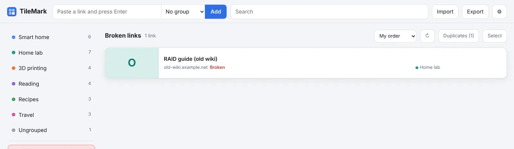

# Broken links

Websites move, close and rename pages. TileMark checks your links regularly and tells you which ones no longer work, so your collection stays useful.

## How it works

- **Once a week**, TileMark checks every link of every account, quietly in the background.
- A link that no longer works gets a red **Broken** label on its card and appears in **Broken links** in the left column.
- When a later check (or **↻** on the card) reaches it again, the label disappears by itself.

A link counts as broken only when:

- its address can't be reached **twice in a row** (a few seconds apart), or
- the site answers that the page **doesn't exist** (error 404 or 410).

Pages behind a sign-in, sites that block automated visits, and temporary server errors are **not** counted. A link isn't flagged just because a site is picky or briefly down.

## Checking now

**⚙ Settings → Link check → Check now** checks your own links straight away. You can close Settings meanwhile; the check continues in the background and the status line shows its progress.

**Refresh all titles and pictures**, in the same place, fetches every title and picture again. Handy after a big import, or when many sites changed their pictures.

## What to do with a broken link

Open **Broken links** and, for each link:

- **✎ Edit** it and fix the address, if the page moved;
- **✕ Delete** it, if the page is gone; or
- leave it: maybe the site is down for a while. The next check clears the label if it comes back.

## For the admin

- The weekly check is switched on or off for everyone in **⚙ Settings → Installation → Check everyone's links automatically once a week**.
- Links to addresses inside your network are skipped while fetching local addresses is off, so they are never reported as broken. See [Local addresses](accounts-and-security.md#local-addresses).
- With [Home Assistant sensors](home-assistant-sensors.md), the number of broken links is a sensor, and the end of each weekly check is an event you can use for a phone notification.
