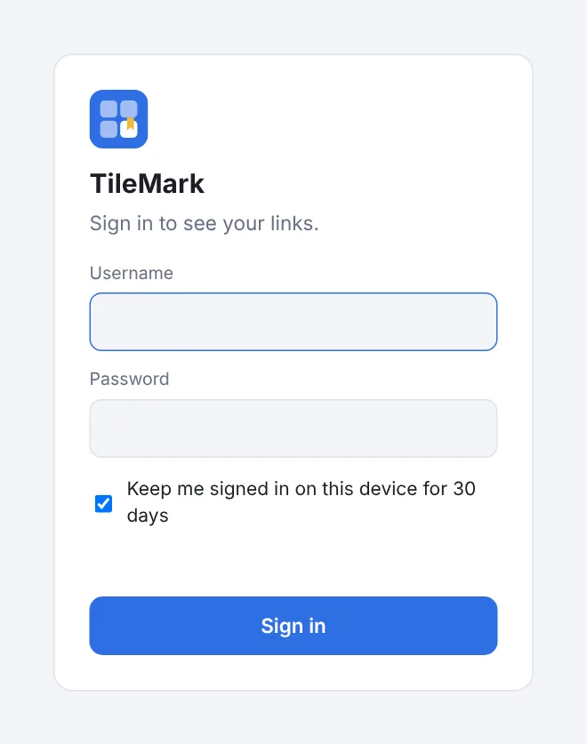

# Getting started

This page takes you from nothing to your first saved links in about five minutes. TileMark runs in **Docker** (any Linux server, NAS, Raspberry Pi, or a Proxmox container) or as a **Home Assistant app**. For the app, see [Home Assistant app](home-assistant-add-on.md) instead.

## What you need

- A machine that is always on, with **Docker and Docker Compose**. [Dockge](https://github.com/louislam/dockge), Portainer and plain Docker all work.
- About 100 MB of disk space for the image, plus a little for your links and pictures.

TileMark needs no database server, no account anywhere and no internet service of its own. It only goes online to fetch the title and picture of the pages you save.

## Install with Docker Compose

1. Create a new stack in Dockge (or an empty folder with a file called `compose.yaml`) and paste this:

   ```yaml
   services:
     tilemark:
       image: ghcr.io/sevagjb/tilemark:latest
       container_name: tilemark
       restart: unless-stopped
       ports:
         - "8080:8080"
       volumes:
         - ./data:/data
   ```

2. Start it: **Deploy** in Dockge, or `docker compose up -d` in that folder.
3. Open `http://<your-server>:8080` in your browser.

Everything TileMark stores (the database, the pictures and the daily backups) lives in the `data` folder next to the compose file. Keep that folder and you keep everything.

> **Port already in use?** Change only the first number, for example `"8090:8080"`, and open port 8090 instead.

## Create the first account



A new installation opens a **welcome screen** that creates the first account. That account is the **admin**: it can add other people later.

The welcome screen asks for a **setup code**. It stops anyone else on your network from claiming a fresh installation before you do. You find it in the container log:

- **Dockge:** open the stack and look at its log.
- **Plain Docker:** `docker logs tilemark`
- **Show it again:** `docker exec tilemark python app.py setup-code`

The code only exists until the first account is made. Choose a username and a password of at least 8 characters, and you are in.

## Save your first links

1. **Paste a link** into the field at the top and press **Enter**. TileMark fetches the title, a short description and a picture in the background; the card fills in a moment later.
2. **Make groups** with **+ New group** (in the left column), give each a name and a colour, and drag cards onto them.
3. **Bring in your bookmarks** with **Import**: export them from your browser first, then choose that file. Each folder becomes a group. See [Import and export](import-export.md).
4. **Add the people in your home** in **⚙ Settings → People**. Each person gets their own private links. See [Accounts and security](accounts-and-security.md).

Next: [Links and groups](links-and-groups.md) explains everything you can do with your links.

## Updating

- **Dockge:** press **Update** on the stack.
- **Plain Docker:** in the folder with `compose.yaml`, run:

  ```bash
  docker compose pull && docker compose up -d
  ```

Your data stays as it is. What changed in each version is in the [changelog](../CHANGELOG.md).

**Coming from LinkBoard?** TileMark is LinkBoard's new name since 2.0.0. Install TileMark fresh and restore your LinkBoard backup in **⚙ Settings → Backup and restore**; old backup files, encrypted or not, are accepted.

**Image tags:**

| Tag | What you get |
| --- | --- |
| `latest` | The newest release. Use this. |
| `2.3` or `2.3.1` | Stays on that release line or exact version. |
| `edge` | Every change on `main` before it is released. For trying out what is coming. |

## Reaching TileMark from outside, with HTTPS

TileMark speaks plain HTTP. At home that is fine: the sign-in keeps other people out of your links. For access from outside your home, or so your password is encrypted on the way, put a **reverse proxy with HTTPS** in front, such as Nginx Proxy Manager, Traefik, Caddy or a Cloudflare tunnel. Point your hostname to `http://<your-server>:8080`.

Nothing needs to change in TileMark. It reads the standard headers a proxy sends, gives HTTPS visitors a secure sign-in cookie, and counts wrong-password attempts per visitor. The same installation can be used through its local address and its HTTPS address at the same time.

HTTPS also unlocks installing TileMark as an app on your phone; see [Save from anywhere](save-from-anywhere.md).

## Container options

Most choices are made in **⚙ Settings** and saved with your account. The container itself has only a few options, set as environment variables:

| Variable | Default | What it does |
| --- | --- | --- |
| `FETCH_WORKERS` | `4` | How many pages are fetched at the same time. Lower it on a very small machine. |
| `DATA_DIR` | `/data` | Where the database, pictures and backups are stored inside the container. |

## Building from source

To build from this repository instead of using the ready-made image, replace the `image:` line with:

```yaml
    build: https://github.com/sevagjb/tilemark.git#main
    pull_policy: build
```

Docker then builds the latest code on every deploy.
