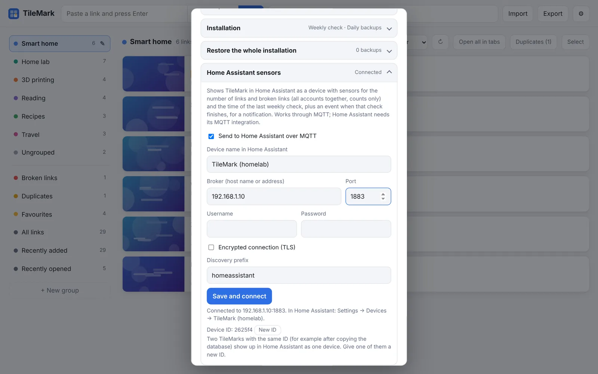

# Home Assistant sensors

TileMark can appear in Home Assistant as a **device** with its own sensors, set up by itself through MQTT discovery: no YAML and no custom integration. Use it on a dashboard, or to get a phone notification when links break.

This works with the [Home Assistant add-on](home-assistant-add-on.md) **and** with TileMark in Docker.

## What you get

| Entity | Type | Shows |
| --- | --- | --- |
| **Links** | Sensor | The number of links, all accounts together. |
| **Broken links** | Sensor | How many links the last check couldn't reach. |
| **Last link check** | Sensor (time) | When the weekly check last ran. |
| **Link check** | Event | Fires when the weekly check finishes, with `checked`, `broken` and `new_broken`. |

Only **numbers** are sent. Nobody's links, titles or addresses ever leave TileMark.

The device page also shows the TileMark version, and a **Visit** link back to TileMark: the sidebar page for the add-on, or the address you use for Docker.

## What you need

An **MQTT broker** that Home Assistant uses. Most people use the **Mosquitto broker** add-on with the **MQTT** integration. If you have other MQTT devices (Zigbee2MQTT, Shelly, Tasmota …), you already have one.

## Turning it on



**In the Home Assistant add-on** it is on by default and uses Home Assistant's own broker by itself. Open **⚙ Settings → Home Assistant sensors** only to check that it says **Connected**, or to change the name.

**In Docker** (admin):

1. Open **⚙ Settings → Home Assistant sensors** and tick **Send to Home Assistant over MQTT**.
2. Fill in the broker:
   - **Broker**: the address of your MQTT broker, for example the address of your Home Assistant (`192.168.1.10`);
   - **Port**: usually `1883` (or `8883` with TLS);
   - **Username** and **Password**: an MQTT user. With the Mosquitto add-on, any Home Assistant user works, or one made for this in the add-on's settings;
   - **Encrypted connection (TLS)**: only if your broker uses it.
3. Press **Save and connect**. The line below says **Connected to …** within a few seconds.
4. In Home Assistant, the device appears under **Settings → Devices & services → Devices**.

### All options

| Option | Meaning |
| --- | --- |
| **Send to Home Assistant over MQTT** | Switches it all on or off. Off removes the device from Home Assistant. |
| **Device name in Home Assistant** | How the device is called. Empty uses the default: "TileMark (Home Assistant)" for the add-on, or "TileMark (address)" for Docker. |
| **Broker, Port** | Where the MQTT broker is. In the add-on, leave the broker empty to use Home Assistant's own. |
| **Username, Password** | The MQTT login. A stored password is kept when you leave the field empty. |
| **Encrypted connection (TLS)** | For brokers that use TLS. |
| **Discovery prefix** | Where Home Assistant looks for new devices. Leave it at `homeassistant` unless you changed it in the MQTT integration. |
| **Device ID / New ID** | See [below](#several-tilemarks-in-one-home-assistant). |

The status line explains what is happening: **Connected**, **Connecting…**, or **Not connected** with the reason (wrong password, broker not reachable …).

## A notification when links break

This automation sends a message to your phone when the weekly check finds newly broken links. Replace the entity with your TileMark's **Link check** entity (open the device page to find its name) and the notify action with your phone:

```yaml
alias: TileMark broken links
triggers:
  - trigger: state
    entity_id: event.tilemark_home_assistant_link_check
conditions:
  - condition: template
    value_template: "{{ trigger.to_state.attributes.new_broken | int(0) > 0 }}"
actions:
  - action: notify.mobile_app_your_phone
    data:
      title: TileMark
      message: >-
        Found {{ trigger.to_state.attributes.new_broken }} new broken links
        ({{ trigger.to_state.attributes.broken }} in total).
```

## Several TileMarks in one Home Assistant

You can run more than one TileMark, for example the add-on and a Docker one. Each appears as its **own device**, as long as they have different device IDs.

Every installation makes up its own **device ID** the first time. But an installation made from another one's database (by copying the `data` folder, or restoring a daily backup into a fresh installation) **starts with the same ID**, and Home Assistant would show the two as one device.

The fix: on one of them, press **New ID** (under the status line) and confirm. Its old entities are removed from Home Assistant and new ones appear. Automations that used the old entities need the new ones. Then give each a clear **Device name**.

## Troubleshooting

- **Not connected: wrong username or password.** Check the MQTT user. With the Mosquitto add-on, the user must exist in Home Assistant or in the add-on's configuration.
- **Connected, but no device in Home Assistant.** Check that the MQTT integration is set up, and that the **Discovery prefix** matches its setting (default `homeassistant`).
- **Entities show "Unavailable".** TileMark is stopped, or lost its connection to the broker. It reconnects by itself.
- **Two TileMarks, one device.** See [above](#several-tilemarks-in-one-home-assistant).
