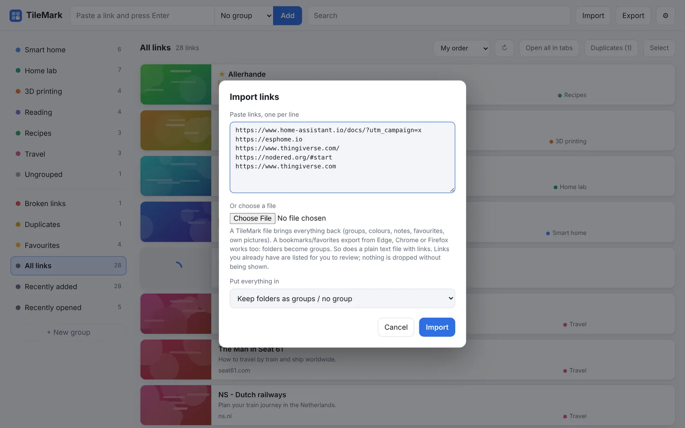
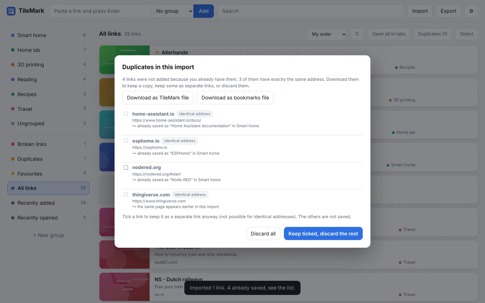
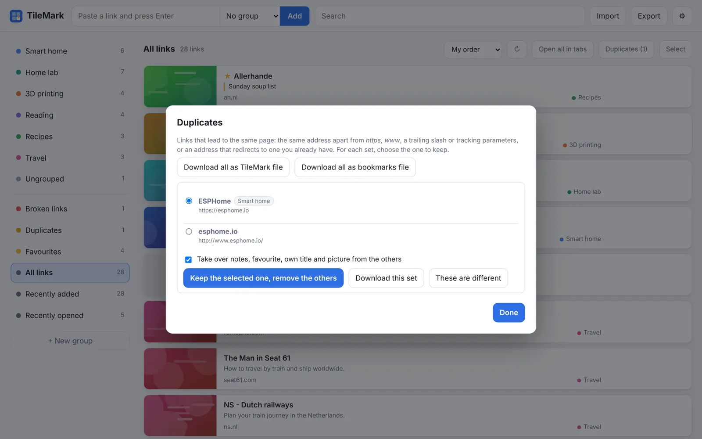
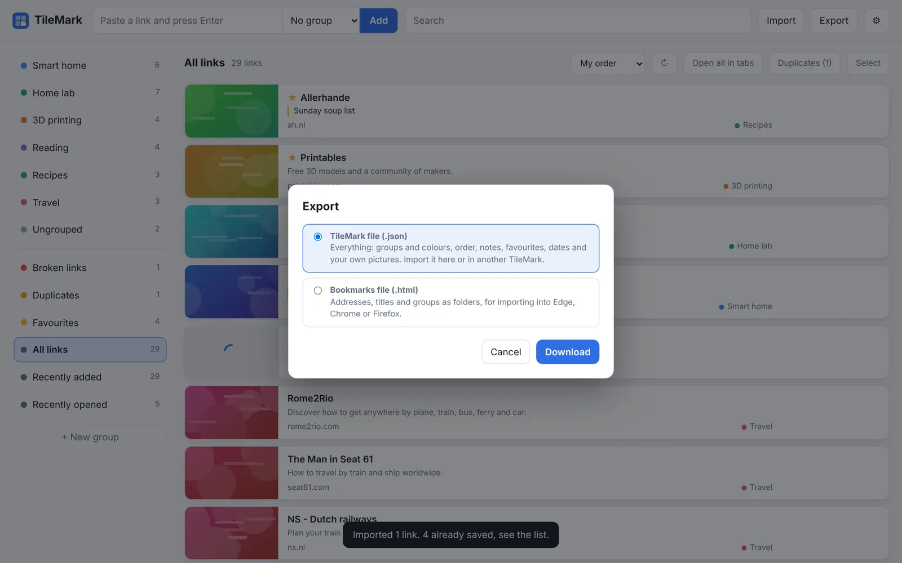

# Import and export

Bring your existing bookmarks into TileMark in one go, and take your links out again whenever you like. Nothing is ever locked in.

## Import

Click **Import** in the top bar. You can:

- **paste links**, one per line, into the box; or
- **choose a file**:
  - a **bookmarks / favorites export** from Edge, Chrome, Firefox, Brave or Safari (`.html`): each folder becomes a group;
  - a **TileMark file** (`.json`, from **Export**): brings back everything, including groups, colours, notes, favourites and your own pictures;
  - a **plain text file** with links.

**Put everything in** chooses where the links go: keep the file's folders as groups (or no group, for pasted links), or put everything into one group you pick.

Pictures and titles are fetched in the background, a few at a time, so a big import fills in over a minute or two. You can keep working meanwhile.

> **Tip:** pasting several lines into the "add a link" field at the top opens this window with them filled in.

### Export your bookmarks from a browser

| Browser | Where |
| --- | --- |
| **Edge** | Favorites (Ctrl+Shift+O) → **⋯** → **Export favorites** |
| **Chrome / Brave** | Bookmark manager (Ctrl+Shift+O) → **⋮** → **Export bookmarks** |
| **Firefox** | Bookmarks → **Manage bookmarks** (Ctrl+Shift+O) → **Import and Backup** → **Export Bookmarks to HTML** |
| **Safari** | **File** → **Export** → **Bookmarks** |

Each saves an `.html` file that TileMark reads directly.

## Duplicates

TileMark recognises when two addresses lead to the **same page**, even when they look a little different. Two addresses count as the same page when they differ only by:

- `http` or `https`, or `www.` or not;
- a slash at the end;
- the order of their parameters, or tracking parameters (`utm_…`, `fbclid`, …);
- a YouTube short form (`youtu.be/…`, `/shorts/…`) versus the normal address;
- a redirect: one address forwards to the other.

### When you save a link

If you already have the page, TileMark tells you where it is (for example *already saved in "Home lab": TrueNAS documentation*) instead of saving it twice.

### When you import

Links you already have are **never added twice and never thrown away silently**. After the import a window lists each one, with the link it matches (or *the same page appears earlier in this import*). From there you can:

- **Download as TileMark file** or **Download as bookmarks file** to keep a copy;
- **tick** links to keep them as separate links anyway (not possible when the address is exactly the same);
- **Keep ticked, discard the rest**, or **Discard all**.

This window stays open until you choose, so nothing is lost by a stray click.

### Cleaning up what you already have

When your saved links contain duplicates, a **Duplicates** button appears in the toolbar (and a **Duplicates** entry in the left column). It shows each set of links that lead to the same page. For each set:

1. Choose the link to **keep**.
2. Optionally tick **Take over notes, favourite, own title and picture from the others**, so nothing you added is lost.
3. Press **Keep the selected one, remove the others**.

**These are different** hides a set for good, for pages that only look alike. **Download this set** (or download all sets at the top) keeps a copy first.

## Export

**Export** in the top bar offers two files:

| File | What is in it | Use it for |
| --- | --- | --- |
| **TileMark file** (`.json`) | Everything: groups and colours, their order, notes, favourites, dates and your own pictures. | Moving to another TileMark or another account, or a readable copy for yourself. |
| **Bookmarks file** (`.html`) | Addresses and titles, with groups as folders. | Importing into Edge, Chrome, Firefox or any other browser. |

Fetched pictures are not included in the TileMark file; they come back by themselves after an import. Your own pictures are included.

Both files are plain, readable files. For an encrypted copy, use a [backup](backups.md) instead.
