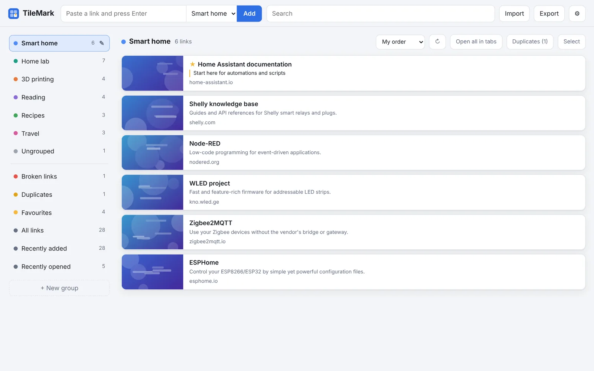
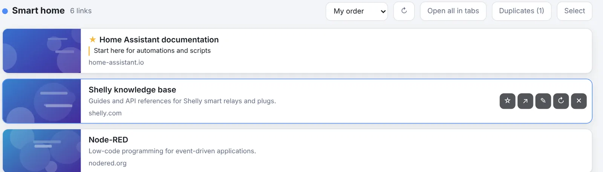
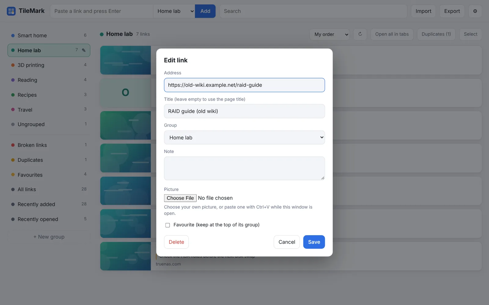
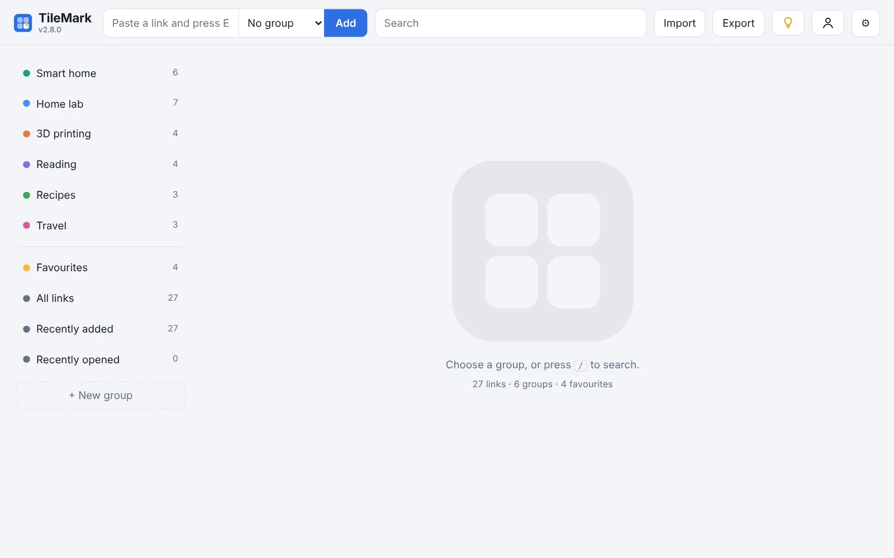
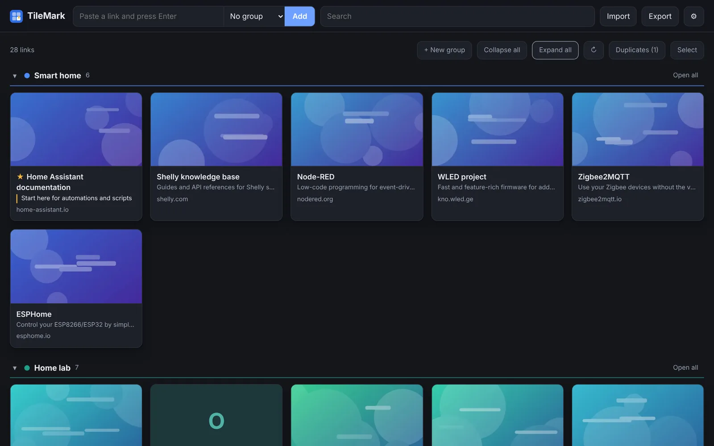
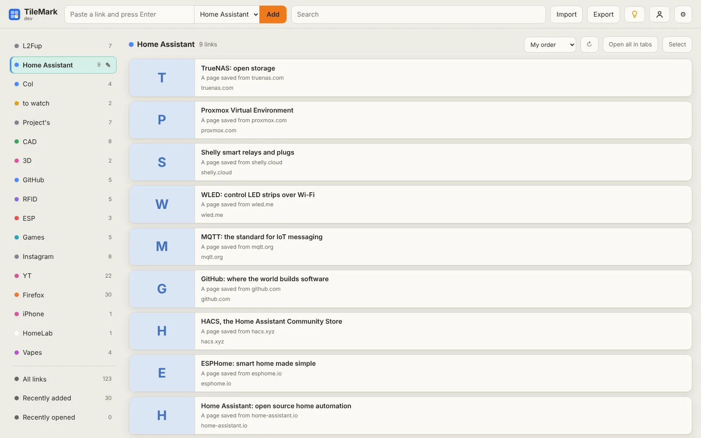
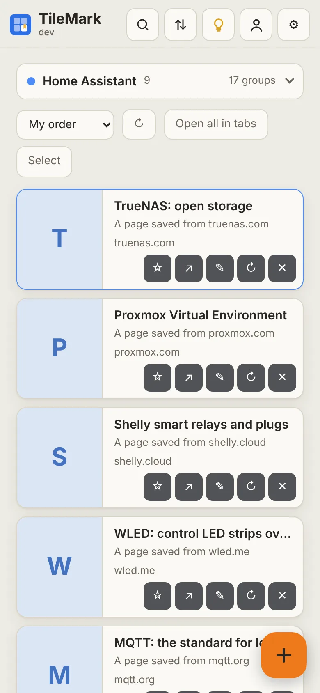
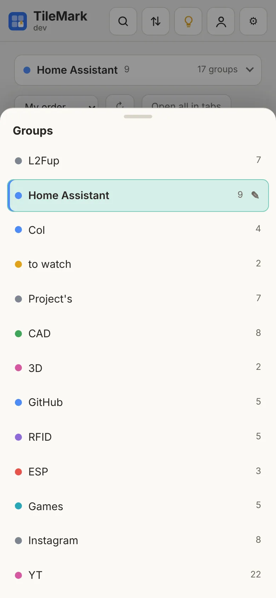

# Links and groups

Everything you do day to day happens on one page. This guide walks through it from top to bottom.

## The top bar

| Part | What it does |
| --- | --- |
| **TileMark** (top left) | The version you are running is shown under the name. |
| **Paste a link and press Enter** | Saves a link. The list next to it chooses the group it goes to. On a phone this is the round **+** button at the bottom instead (see [On a phone](#on-a-phone)). |
| **Add** | Same as pressing Enter. |
| **Search** | Finds links by title, address, description, note or group name, across all your groups. |
| **Import** | Brings in browser bookmarks, a list of links or a TileMark file. See [Import and export](import-export.md). |
| **Export** | Downloads your links as a TileMark file or a bookmarks file. |
| **Light bulb** | Opens this guide on the website. |
| **👤** | Opens [Your account](settings.md): your sign-in and your own choices, in a panel that slides in from the right. |
| **⚙** | Opens [Settings](settings.md#-settings-admin), the settings of the whole installation. Only admins see this button. |

## Saving a link

Paste an address into the field at the top and press **Enter**. The card appears at once; TileMark then fetches the page's **title**, a short **description** and a **picture** in the background, and the card fills in a moment later.

- **Which group?** The list next to the field. It starts on the group you are looking at, or on the group set under **👤 Your account → Cards and tile size → New links go to**.
- **Several links at once:** paste several lines into the field. TileMark opens the import window with them filled in.
- **No `http://`?** Addresses typed without it get `https://`. Local ones (`192.168.x.x`, `localhost`, `name.local`) get `http://`.
- **Tracking removed:** parameters that only track you (`utm_…`, `fbclid`, `gclid`, YouTube's and Spotify's `si` …) are removed before saving.
- **Already saved?** TileMark tells you where the link already is instead of saving it twice. See [Duplicates](import-export.md#duplicates).
- **Saved somewhere else?** Links you add with the browser button, from your phone or on another device show up when you come back to the TileMark tab, and otherwise within 5 minutes.

### Where the picture comes from

TileMark uses the preview image a site publishes for sharing (the same one you see when you paste a link in a chat app). For YouTube, Vimeo and TikTok it asks their official embed service. If a site has no preview image, the site's icon is used, and otherwise a letter tile.

Pictures are stored on your server, so the page stays fast and keeps working when a site changes. You can always use **your own picture** instead; see [Editing a link](#editing-a-link).

Sites that need you to sign in (Instagram, for example) and pages inside your own network often have no picture. For local pages, see [Local addresses](accounts-and-security.md#local-addresses).

## The card

Click a card to open the link. Point at a card (on a phone they are always shown) to see its buttons:

| Button | What it does |
| --- | --- |
| **☆ / ★** | Favourite: keeps the link at the top of its group and in the **Favourites** list. |
| **↗** | Share: opens the phone's share menu, or copies the address where there is none. |
| **✎** | Edit the link (below). |
| **↻** | Fetch the title and picture again. |
| **✕** | Delete the link. |

A card can also show:

- a **note** (with a coloured line in front of it), if you added one;
- a **Broken** label, if the last link check could not reach it (see [Broken links](broken-links.md));
- the **group's name**, in lists that mix groups (All links, Favourites, search results).

Whether a click opens the link in a new tab or in the same tab is set in **👤 Your account → Cards and tile size**. A middle-click or Ctrl-click always opens a new tab.

### Editing a link

The **✎** button opens the edit window:

| Field | What it does |
| --- | --- |
| **Address** | The link itself. Changing it fetches the title and picture again. |
| **Title** | Your own title. Leave it empty to use the page's own title. |
| **Group** | Moves the link to another group. |
| **Note** | Your own note, shown on the card and found by search. |
| **Picture** | Choose an image file (JPEG, PNG, WebP, GIF, ICO or AVIF, at most 20 MB), or **paste** an image with Ctrl+V while the window is open. **Use the site's picture again** goes back to the fetched one. |
| **Favourite** | Keeps the link at the top of its group. |
| **Delete** | Deletes the link. |

## Groups

Groups are like folders, or like the tab groups in your browser: each has a **name** and a **colour**, and they appear in the order you choose.

- **New group:** **+ New group** in the left column (or in the toolbar, in the Sections layout).
- **Edit a group:** the **✎** next to its name. There you change the name and colour (pick one, or **Other colour…** for any colour), choose its **Place in the list**, or **Delete group**. Deleting a group keeps its links; they become ungrouped.
- **Move a link to a group:** drag the card onto the group in the left column, or use **✎** on the card.
- **Reorder groups:** drag a group onto another one in the left column.
- **Open all in tabs:** opens every link of the group at once. Your browser may ask you to allow pop-ups the first time.

### Lists that are always there

Below your groups, the left column has lists TileMark keeps for you:

| List | What it shows |
| --- | --- |
| **Ungrouped** | Links that are not in any group. |
| **Broken links** | Links the last check could not reach. Only shown when there are some. |
| **Duplicates** | Sets of links that lead to the same page. Only shown when there are some. |
| **Favourites** | All links with a ★. |
| **All links** | Everything. |
| **Recently added** | Your 30 newest links. |
| **Recently opened** | The 30 links you opened last. |

## Sharing a group

You can share a group with someone else who has an account on the same TileMark. They can **look, not change**: the group stays yours, and so do its links.

### Sharing (the owner)

1. Press **✎** next to the group.
2. Under **Share with**, enter their **username** and press **Share**:
   - **Admins** can pick it from the list of accounts that opens as you type (or with the arrow in the field).
   - **Everyone else** types the **exact username**, so nobody learns which other accounts exist. An admin can show the list to everyone with **⚙ Settings → Installation → Show the list of accounts to everyone when sharing a group**, for a household where everyone knows each other.
3. The group now shows **⇄** in your list. You can share one group with several people.

To **stop sharing**, open **✎** again and press **Stop sharing** next to their name. The group and its links disappear from their TileMark straight away.

Everything you change in the group (adding, editing, moving or deleting links, renaming the group) they see the next time their page loads. If you delete the group, it disappears for them too.

> They see each link's **title, address, note and picture**. Keep private reminders out of the notes of links in a shared group.

### A group shared with you

Groups other people share with you are listed under **Shared with me**, with the owner's name next to them. You can:

- **open** and **search** their links, and use **Open all in tabs**;
- mark a link as a **favourite ★** for yourself. The owner doesn't see your favourites, and your **Recently opened** list stays your own;
- **copy** a link to your own links with **⧉** on the card, or copy them all with **ⓘ → Copy all**. A copy is **your own link**: you can change it, and it stays when the sharing ends;
- **leave** the group with **ⓘ → Leave this group**. Only the owner can share it with you again.

You can't add, edit, move or delete links in someone else's group, and nothing can be dragged onto it. Their links count in **All links**, **Favourites**, **Recently added** and **Recently opened**, but never in your duplicates, your exports or your backup.

What happens to sharing when a backup is restored: see [Backups and shared groups](backups.md#backups-and-shared-groups).

## Two layouts

Choose in **👤 Your account → Layout**. The choice is saved with your account, so all your devices look the same.

**Side panel** (shown above): groups in a column on the left; click one to list its links beside it. Compact, and quick with many groups.

When TileMark opens, no group is open yet: you see the TileMark logo, a short hint and how many links, groups and favourites you have. Click a group to open it, and **click it again** (or press **Esc**) to close it and go back to that clean screen. Prefer to start where you left off? Choose **Reopen the last group** in **👤 Your account → Start screen**.

**Sections:** all groups on one page as collapsible sections with large picture cards. **Collapse all** and **Expand all** fold every section at once; click a section's title to fold just that one.

## Tile size

**👤 Your account → Cards and tile size → Tile size** has four steps: **Extra small**, **Small**, **Medium** and **Large**. **Extra small** is handy for long lists. In the **Side panel** layout it is a slim list, one link per line, with the site's icon, the title and the address on the right (and the group, in lists like All links); hover over a line for its buttons. In **Sections** it is a dense grid of small tiles with only the icon and the title. On a phone, and in that grid, the only card button is **✎**, which opens the link's window with favourite, group and delete. Each device remembers its own size, so your phone can show Extra small while your computer shows Medium.

## Ordering and sorting

- **Your own order:** drag a card inside its group to move it. This works inside a group, not in mixed lists like All links or search results.
- **Sort:** the list above the cards sorts a group by **My order**, **Newest first**, **Oldest first**, **Name** or **Site**. Each group remembers its own choice.
- **Favourites** always come first in their group.

## Working with several links

**Select** (top right) turns on selection mode. Click cards to tick them, or use **Select all**. Then:

- **Move to…** puts them in another group;
- **Refresh** fetches their titles and pictures again;
- **Delete** removes them;
- or drag the whole selection onto a group.

**Done** leaves selection mode. **↻** in the toolbar refreshes every link shown at that moment, for example a whole group.

## Search

Type in **Search** to find links by title, address, description, note or group name. Results come from all your groups; clear the field (or press **Esc**) to go back.

On a phone, tap the magnifier next to the name to open the search field. It closes again when you leave it empty.

## Keyboard shortcuts

TileMark can be used without a mouse. The shortcuts work on a computer with a keyboard; a phone has none.

**Anywhere on the page**

| Key | What it does |
| --- | --- |
| `/` | Jump to the search field and select what's in it. |
| `n` | Jump to the field for adding a link. |
| `Esc` | Does the first of these that applies: close a menu (such as Import and export), close a window or the 👤 / ⚙ panel, stop selecting links, clear the search, leave the field you're typing in, or close the open group and go back to the start screen. |

**In a field**

| Key | Where | What it does |
| --- | --- | --- |
| `Enter` | The field for adding a link | Saves the link. Pasting several links at once (one per line) opens **Import** with them instead. |
| `Enter` | **Search** | Nothing extra: results show while you type. `Esc` clears it. |
| `Enter` | A group's **Name**, **Share with**, a two-factor code | Saves, shares or confirms, the same as the button next to it. |

**Moving around**

| Key | What it does |
| --- | --- |
| `Tab` / `Shift+Tab` | Move between the fields, buttons, groups and cards. The one you're on gets a coloured ring. |
| `Enter` or `Space` | On a group: open it, or close it when it's already open. On a section's title (Sections layout): fold or unfold it. |
| `Enter` | On a card: open the link. |

**When they don't work:** while a window is open in the middle of the screen, while you're typing in a field (only `Esc` works there), and while you hold `Ctrl`, `Alt` or `⌘`, so the browser's own shortcuts (such as `Ctrl+F`) keep working.

**Browser extension:** `Alt+Shift+S` opens its window on any page, and `Ctrl+Enter` in the note saves. See [Browser extension](browser-extension.md#saving).

**On a phone:** no keyboard shortcuts. To save from other apps, use the Share menu (Android) or an [iPhone Shortcut](save-from-anywhere.md#iphone-shortcut).

## Light, dark and languages

**👤 Your account → Appearance** has two choices for the colours:

- **Style:** **Classic** (cool greys with blue buttons) or **Workshop** (cream and warm charcoal, with orange buttons and teal for the selected group). The TileMark logo stays blue in both.
- **Mode:** **Light**, **Dark**, or **Follow my device**, which switches with your computer's or phone's dark mode. This works for both styles.

The same card chooses the language: English, Nederlands (Dutch), Deutsch (German), Français (French), Español (Spanish) or العربية (Arabic, shown right to left). By default TileMark follows your browser's language. See [Settings](settings.md#appearance).

## Width and spacing

Two switches in **👤 Your account → Cards and tile size**, remembered on each device, like the tile size:

- **Full width:** on a big screen, TileMark is a centred page at most 1500 pixels wide, with empty space on both sides. Full width lets it use the whole screen. It has no effect on phones, which always use the whole screen.
- **Compact:** less space around groups, cards and rows, so more fits on the screen. The text stays the same size.

## On a phone

TileMark works in any phone browser, laid out for a small screen:

- **Groups button:** at the top it shows the open group, how many links it has, and how many groups you have. Tap it to see all your groups, Favourites, All links and the other lists as a sheet from the bottom of the screen; tap one to open it. Close the sheet by tapping beside it or swiping its handle down. In the **Sections** layout the same button is called **Jump to a group**: it scrolls straight to that group's section and unfolds it.
- **Round + button:** bottom right (bottom left in Arabic). It opens a small sheet with the link field and the group; tap **Add**. Pasting several links at once opens **Import** with them.
- **Card buttons** sit under each link, so they're easy to tap.
- **Status bar:** the phone's status bar and the browser's toolbar take the colour of your style and mode.

 

With HTTPS you can also install TileMark as an app and share links to it from other apps; see [Save from anywhere](save-from-anywhere.md#phone).
