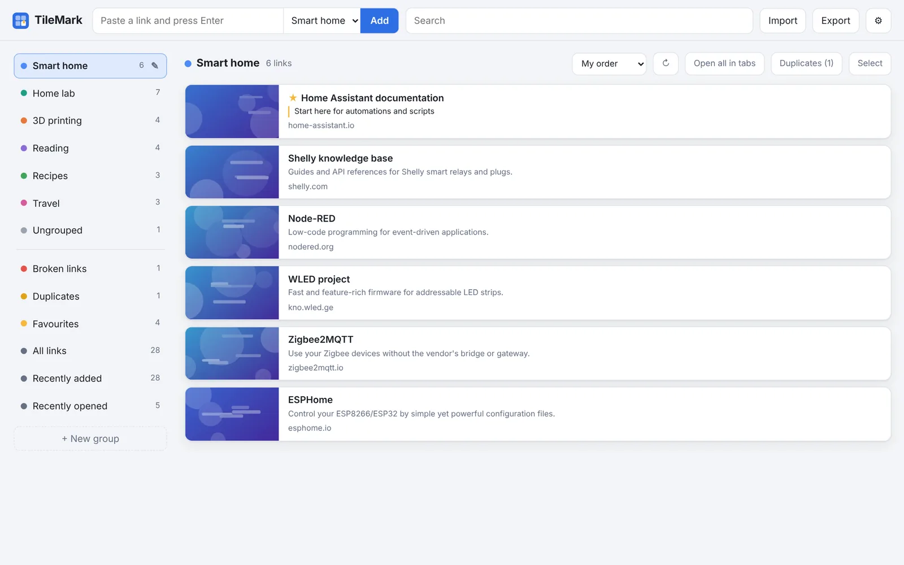
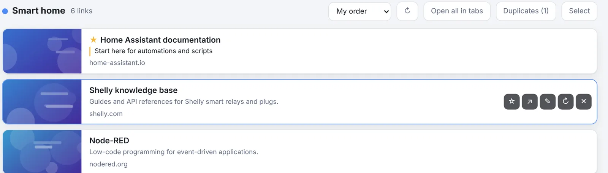
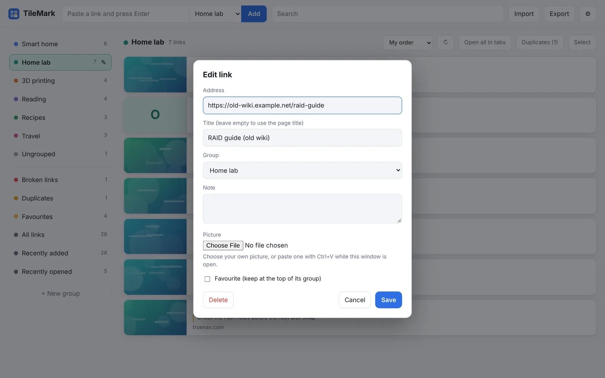
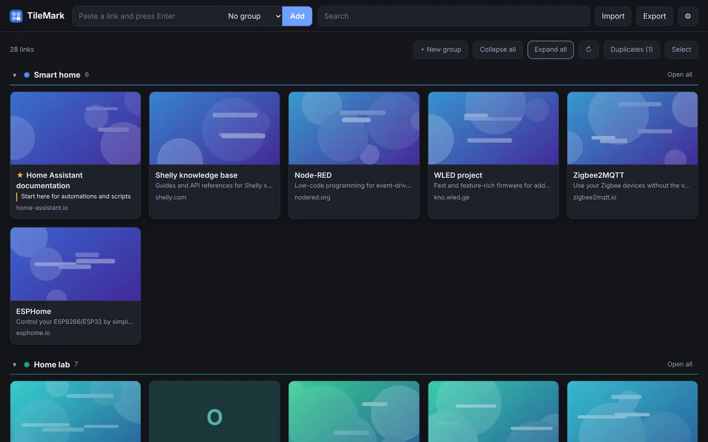
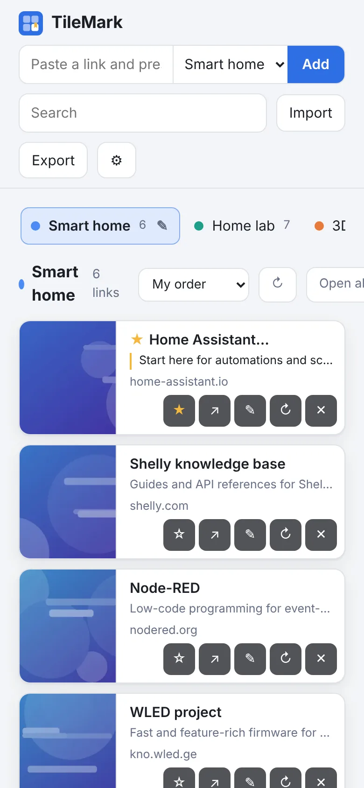

# Links and groups

Everything you do day to day happens on one page. This guide walks through it from top to bottom.

## The top bar

| Part | What it does |
| --- | --- |
| **TileMark** (top left) | The version you are running is shown under the name. |
| **Paste a link and press Enter** | Saves a link. The list next to it chooses the group it goes to. |
| **Add** | Same as pressing Enter. |
| **Search** | Finds links by title, address, description, note or group name, across all your groups. |
| **Import** | Brings in browser bookmarks, a list of links or a TileMark file. See [Import and export](import-export.md). |
| **Export** | Downloads your links as a TileMark file or a bookmarks file. |
| **Light bulb** | Opens this guide on the website. |
| **⚙** | Opens [Settings](settings.md). |

## Saving a link

Paste an address into the field at the top and press **Enter**. The card appears at once; TileMark then fetches the page's **title**, a short **description** and a **picture** in the background, and the card fills in a moment later.

- **Which group?** The list next to the field. It starts on the group you are looking at, or on the group set under **⚙ Settings → Cards → New links go to**.
- **Several links at once:** paste several lines into the field. TileMark opens the import window with them filled in.
- **No `http://`?** Addresses typed without it get `https://`. Local ones (`192.168.x.x`, `localhost`, `name.local`) get `http://`.
- **Tracking removed:** parameters that only track you (`utm_…`, `fbclid`, `gclid`, YouTube's and Spotify's `si` …) are removed before saving.
- **Already saved?** TileMark tells you where the link already is instead of saving it twice. See [Duplicates](import-export.md#duplicates).
- **Saved somewhere else?** Links you add with the browser button, from your phone or on another device show up when you come back to the TileMark tab, and otherwise within 5 minutes.

### Where the picture comes from

TileMark uses the preview image a site publishes for sharing (the same one you see when you paste a link in a chat app). For YouTube, Vimeo and TikTok it asks their official embed service. If a site has no preview image, the site's icon is used, and otherwise a letter tile.

Pictures are stored on your server, so the page stays fast and keeps working when a site changes. You can always use **your own picture** instead; see [Editing a link](#editing-a-link).

Sites that need you to sign in (Instagram, for example) and pages inside your own network often have no picture. For local pages, see [Local addresses](accounts-and-security.md#local-addresses).

## The card

Click a card to open the link. Point at a card (on a phone they are always shown) to see its buttons:

| Button | What it does |
| --- | --- |
| **☆ / ★** | Favourite: keeps the link at the top of its group and in the **Favourites** list. |
| **↗** | Share: opens the phone's share menu, or copies the address where there is none. |
| **✎** | Edit the link (below). |
| **↻** | Fetch the title and picture again. |
| **✕** | Delete the link. |

A card can also show:

- a **note** (with a coloured line in front of it), if you added one;
- a **Broken** label, if the last link check could not reach it (see [Broken links](broken-links.md));
- the **group's name**, in lists that mix groups (All links, Favourites, search results).

Whether a click opens the link in a new tab or in the same tab is set in **⚙ Settings → Cards**. A middle-click or Ctrl-click always opens a new tab.

### Editing a link

The **✎** button opens the edit window:

| Field | What it does |
| --- | --- |
| **Address** | The link itself. Changing it fetches the title and picture again. |
| **Title** | Your own title. Leave it empty to use the page's own title. |
| **Group** | Moves the link to another group. |
| **Note** | Your own note, shown on the card and found by search. |
| **Picture** | Choose an image file, or **paste** an image with Ctrl+V while the window is open. **Use the site's picture again** goes back to the fetched one. |
| **Favourite** | Keeps the link at the top of its group. |
| **Delete** | Deletes the link. |

## Groups

Groups are like folders, or like the tab groups in your browser: each has a **name** and a **colour**, and they appear in the order you choose.

- **New group:** **+ New group** in the left column (or in the toolbar, in the Sections layout).
- **Edit a group:** the **✎** next to its name. There you change the name and colour (pick one, or **Other colour…** for any colour), choose its **Place in the list**, or **Delete group**. Deleting a group keeps its links; they become ungrouped.
- **Move a link to a group:** drag the card onto the group in the left column, or use **✎** on the card.
- **Reorder groups:** drag a group onto another one in the left column.
- **Open all in tabs:** opens every link of the group at once. Your browser may ask you to allow pop-ups the first time.

### Lists that are always there

Below your groups, the left column has lists TileMark keeps for you:

| List | What it shows |
| --- | --- |
| **Ungrouped** | Links that are not in any group. |
| **Broken links** | Links the last check could not reach. Only shown when there are some. |
| **Duplicates** | Sets of links that lead to the same page. Only shown when there are some. |
| **Favourites** | All links with a ★. |
| **All links** | Everything. |
| **Recently added** | Your 30 newest links. |
| **Recently opened** | The 30 links you opened last. |

## Two layouts

Choose in **⚙ Settings → Layout**. The choice is saved with your account, so all your devices look the same.

**Side panel** (shown above): groups in a column on the left; click one to list its links beside it. Compact, and quick with many groups.

**Sections:** all groups on one page as collapsible sections with large picture cards. **Collapse all** and **Expand all** fold every section at once; click a section's title to fold just that one.

## Ordering and sorting

- **Your own order:** drag a card inside its group to move it. This works inside a group, not in mixed lists like All links or search results.
- **Sort:** the list above the cards sorts a group by **My order**, **Newest first**, **Oldest first**, **Name** or **Site**. Each group remembers its own choice.
- **Favourites** always come first in their group.

## Working with several links

**Select** (top right) turns on selection mode. Click cards to tick them, or use **Select all**. Then:

- **Move to…** puts them in another group;
- **Refresh** fetches their titles and pictures again;
- **Delete** removes them;
- or drag the whole selection onto a group.

**Done** leaves selection mode. **↻** in the toolbar refreshes every link shown at that moment, for example a whole group.

## Search

Type in **Search** to find links by title, address, description, note or group name. Results come from all your groups; clear the field (or press **Esc**) to go back.

On a phone, tap the magnifier next to the name to open the search field. It closes again when you leave it empty.

## Keyboard shortcuts

| Key | What it does |
| --- | --- |
| `/` | Jump to the search field |
| `n` | Jump to the field for adding a link |
| `Esc` | Clear the search, leave a field, or close a window |

## Light, dark and languages

**⚙ Settings → Appearance** chooses light, dark, or **Follow my device**, and the language: English, Nederlands (Dutch) or العربية (Arabic, shown right to left). By default TileMark follows your browser's language. See [Settings](settings.md#appearance).

## On a phone

TileMark works in any phone browser: the groups become a row you can swipe, and the card buttons sit under each link. With HTTPS you can also install it as an app and share links to it from other apps; see [Save from anywhere](save-from-anywhere.md#phone).

