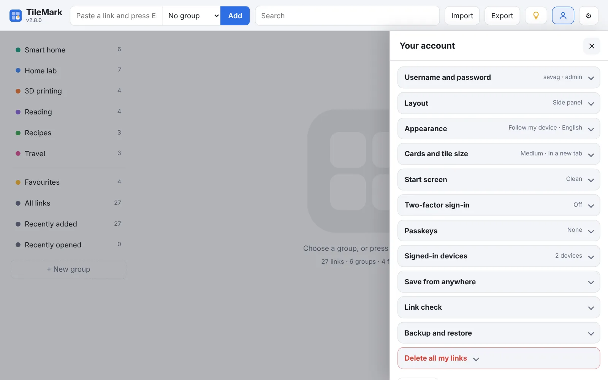
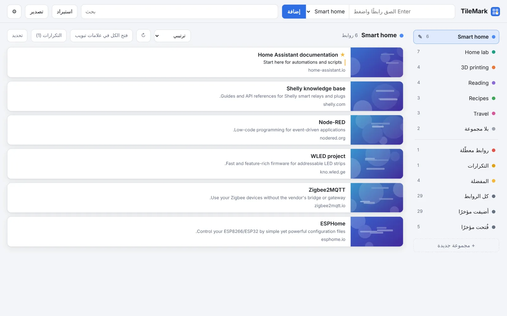

# Your account and Settings

TileMark has two side panels, both opened from the top right. They slide in from the right (from the left in Arabic), just under the toolbar, and close with **✕**, **Esc**, a click beside the panel, or the same button again.

- **👤 Your account**, for everyone: your sign-in, your own choices and your own links.
- **⚙ Settings**, for admins only: the settings of the whole installation. Other people don't see this button.

In both, each section is a card: click its title to open it. Only one card is open at a time, and a closed card shows a short status, so you often don't need to open it at all.

**On this page:** 👤 [Username and password](#username-and-password) · [Layout](#layout) · [Appearance](#appearance) · [Cards and tile size](#cards-and-tile-size) · [Start screen](#start-screen) · [Two-factor sign-in](#two-factor-sign-in) · [Passkeys](#passkeys) · [Signed-in devices](#signed-in-devices) · [Save from anywhere](#save-from-anywhere) · [Link check](#link-check) · [Backup and restore](#backup-and-restore) · [Delete all my links](#delete-all-my-links) — ⚙ [People](#people) · [Installation](#installation) · [Restore the whole installation](#restore-the-whole-installation) · [Home Assistant sensors](#home-assistant-sensors) · [Reset TileMark](#reset-tilemark)

---

# 👤 Your account

Your own choices (layout, appearance, language, cards, start screen) are saved **with your account**, so every device you use looks the same. The one exception is the **tile size**, which each device remembers for itself.

## Username and password

| Option | What it does |
| --- | --- |
| **Username** | Your name for signing in. |
| **New password** | Leave empty to keep your current one. At least 8 characters. A new password signs out your other devices. |
| **Current password** | Needed to save any change. |
| **Save account** | Saves the changes above. |

In the [Home Assistant app](home-assistant-add-on.md) you are signed in through Home Assistant; set a password here only if you also want to use TileMark's own address.

## Layout

| Option | What it does |
| --- | --- |
| **Side panel** | Groups in a column on the left; click one to list its links beside it. Good with many groups. |
| **Sections** | All groups on one page as collapsible sections with large picture cards. |

More in [Links and groups](links-and-groups.md#two-layouts).

## Appearance

| Option | What it does |
| --- | --- |
| **Follow my device / Light / Dark** | The colour scheme. *Follow my device* switches with your computer's or phone's dark mode. |
| **Language** | **Follow my browser** (the default), **English**, **Nederlands**, **Deutsch**, **Français**, **Español** or **العربية**. Arabic is shown right to left. The page reloads in the chosen language. |

## Cards and tile size

| Option | What it does |
| --- | --- |
| **Tile size** | **Extra small**, **Small**, **Medium** or **Large**. Extra small is for long lists: in the **Side panel** layout a slim list with one link per line (the site's icon, the title, and the address on the right), in **Sections** a dense grid of small tiles with only the icon and the title. On a phone, and in the Sections grid, its only card button is **✎**, whose window has favourite, group and delete. **Remembered on each device**, so your phone and your computer can each have their own size. A new device starts with the size you chose last. |
| **Clicking a link opens it** | **In a new tab** (the default) or **In this tab**. |
| **New links go to** | The group that new links go to when you aren't looking at a group. **No group** leaves them ungrouped. |

The keyboard shortcuts are listed here too: `/` search, `n` add a link, `Esc` clear the search, leave a field, or close a panel or the open group.

## Start screen

Used with the **Side panel** layout.

| Option | What it does |
| --- | --- |
| **Clean start screen** (the default) | No group is open when TileMark starts: you see the TileMark logo, a short hint and how many links, groups and favourites you have. Click a group to open it; click it again, or press **Esc**, to close it and go back to this screen. |
| **Reopen the last group** | TileMark opens with the group (or list) that was open last. |

## Two-factor sign-in

Asks for a code from an authenticator app after your password. Shows **On** or **Off** in the card's title.

| Button | What it does |
| --- | --- |
| **Turn on** | Shows a QR code to scan with your authenticator app; confirm with one code. You then get ten recovery codes. |
| **New recovery codes** | Replaces your recovery codes. Asks for your password. |
| **Turn off** | Switches it off. Asks for your password. |

Step by step, and what to do when you lose your phone: [Accounts and security](accounts-and-security.md#two-factor-sign-in). Not shown in the Home Assistant sidebar.

## Passkeys

Sign in with your phone, computer or security key instead of your password. The card's title shows how many you have.

| Part | What it does |
| --- | --- |
| The list | Your passkeys, with when each was added and last used. |
| **Add a passkey** | Asks for your password, then lets your browser or phone make a passkey, and asks for a name. |
| **Rename** | Changes a passkey's name. |
| **Remove** | Stops that passkey working for TileMark. |

Only on TileMark's HTTPS address with a name, not on an IP address or plain http. Step by step: [Accounts and security](accounts-and-security.md#passkeys). Not shown in the Home Assistant sidebar.

## Signed-in devices

Lists every browser signed in to your account: browser and system, address, when it was last active and when it signed in.

| Button | What it does |
| --- | --- |
| **Sign out** | Signs that device out. |
| **Sign out all other devices** | Signs out every device except this one. |

## Save from anywhere

| Part | What it does |
| --- | --- |
| **🔖 Save to TileMark** | A button to **drag** to your browser's favorites bar. Click it on any page to save that page. |
| **Phone** | How to install TileMark as an app on your phone (needs HTTPS). |
| **Create API key** | Makes a key for scripts and Shortcuts. It is shown once. |
| **Replace API key** | Makes a new key; the old one stops working. |
| **Remove API key** | Switches the key off. |

Details and examples: [Save from anywhere](save-from-anywhere.md).

## Link check

| Part | What it does |
| --- | --- |
| Status line | When the last check ran, and how many of your links are broken. |
| **Check now** | Checks your links now, in the background. For an admin: the links of every account, the same as the weekly check. |
| **Refresh all titles and pictures** | Fetches the title and picture of all your links again. |

More in [Broken links](broken-links.md).

## Backup and restore

| Option | What it does |
| --- | --- |
| **Download backup** | Downloads one file with all your links, groups and pictures, encrypted with your login password. |
| **More options → A different password instead** | Encrypts with a password of your choice instead, for example to give the file to someone. Can't be recovered if forgotten. |
| **More options → No encryption** | A plain zip file that anyone can open. |
| **Restore: choose file** | The backup file to restore (`.tmk` or `.zip`; LinkBoard backups work too). |
| **Password** | Your login password (from the day of the backup, or today's), or the backup's own password. |
| **Restore from backup** | Replaces **all** your links and groups with those in the file, after you confirm. |

More in [Backups](backups.md).

## Delete all my links

The last card, marked in red. Deletes all your links, groups and pictures, for a fresh start; your account, settings and passkeys stay. Asks you to confirm and for your password. **Download backup first** downloads your backup before you do.

At the bottom of Your account: **Sign out** (signs you out on this device; not shown in the Home Assistant sidebar, where Home Assistant's own sign-in applies) and the version of TileMark you are running.

---

# ⚙ Settings (admin)

Only admins see the **⚙** button. These cards affect every account. The server refuses these changes from anyone who isn't an admin, whatever the page shows.

## People

| Part | What it does |
| --- | --- |
| The list | Everyone with an account, with their number of links, and whether they are admin or use two-factor sign-in. |
| **New password** | Sets a new password for that person and signs them out everywhere. |
| **Make admin / Remove admin** | Gives or takes admin rights. There is always at least one admin. |
| **Turn off 2FA** | Switches off their two-factor sign-in, for when they lost their phone. |
| **Remove** | Deletes the account with all its links, groups and pictures. Can't be undone. |
| **Add a person** | Username, first password (at least 8 characters) and **Also an admin**, then **Add person**. |

More in [Accounts and security](accounts-and-security.md#adding-people-admin).

## Installation

| Option | Default | What it does |
| --- | --- | --- |
| **Check everyone's links automatically once a week** | On | The weekly [link check](broken-links.md) for all accounts. |
| **Keep a daily backup of the whole installation** | On (off in Home Assistant) | Daily copies of everything in `data/backups`, the last 7 kept. The status line shows the last one. See [Backups](backups.md#daily-backups-of-the-whole-installation). |
| **Fetch titles and pictures for local network addresses** | Off | Lets TileMark visit addresses inside your network (`192.168.x.x`, `nas.local` …). Turn it on only if you trust everyone with an account. See [Local addresses](accounts-and-security.md#local-addresses). |

## Restore the whole installation

| Part | What it does |
| --- | --- |
| Encryption status | Whether the daily backups are encrypted (🔒 in the card's title). |
| **Turn on encryption** | Encrypts every new backup. First tells you which unencrypted backups will be deleted and asks you to confirm; then shows a recovery key once. |
| **New recovery key** | Replaces the recovery key. Asks for your password or the current recovery key. |
| **Turn off encryption** | New backups are no longer encrypted; the encrypted ones stay readable. |
| **Recovery key → Get access again** | Shown when your password doesn't open the backups (for example after a password reset). |
| The list | The daily backups and the safety copies made before a restore or a reset, newest first, with 🔒 on encrypted ones. |
| **Download** | Downloads that backup. |
| **Restore** | Puts every account back to that day. Type the date to confirm, and for an encrypted backup your password or the recovery key; a safety copy of now is made first. |
| **Make a backup now** | Makes a backup straight away. |

More in [Backups](backups.md#encrypting-the-daily-backups-admin).

## Home Assistant sensors

| Option | What it does |
| --- | --- |
| **Send to Home Assistant over MQTT** | Shows TileMark in Home Assistant as a device with sensors. On by default in Home Assistant. |
| **Device name in Home Assistant** | The device's name. Empty uses the default. |
| **Broker, Port, Username, Password** | Your MQTT broker. In Home Assistant, leave the broker empty to use Home Assistant's own. |
| **Encrypted connection (TLS)** | For brokers that use TLS. |
| **Discovery prefix** | Leave at `homeassistant` unless you changed it in Home Assistant. |
| **Save and connect** | Saves and connects. The status line shows the result. |
| **Device ID / New ID** | Gives this installation a new device in Home Assistant, for when two TileMarks share one ID. |

More in [Home Assistant sensors](home-assistant-sensors.md).

## Reset TileMark

The last card, marked in red. It deletes every account, link, picture and setting, and TileMark starts again as if just installed.

| Part | What it does |
| --- | --- |
| **Download my backup first** | Downloads your own backup before you reset. |
| **Also delete every backup in the data folder** | Off: a copy of everything is kept and listed as **Before reset**, so the reset can be undone. On: no copy is kept and every backup is deleted. |
| **Type RESET to confirm** | Must be typed exactly, in capital letters. |
| **Your password**, **code** | Your password, and your two-factor code when that's on. Not asked inside the Home Assistant sidebar. |
| **Reset TileMark** | Resets after one more confirmation. |

More in [Accounts and security](accounts-and-security.md#resetting-tilemark-admin).
