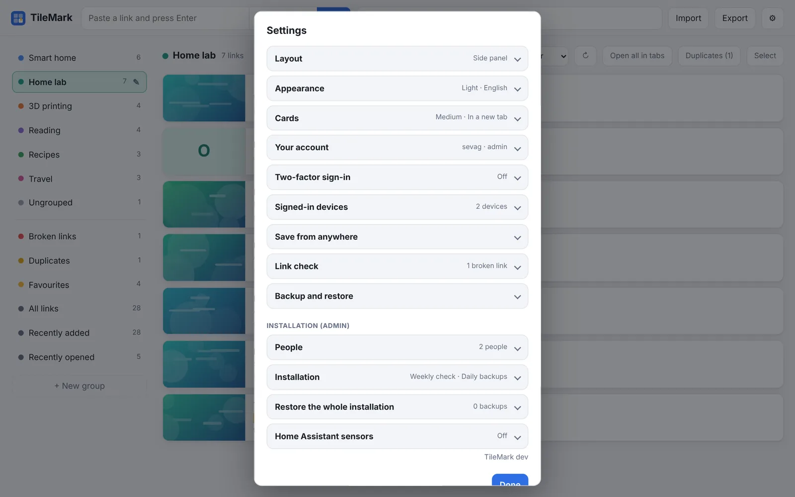
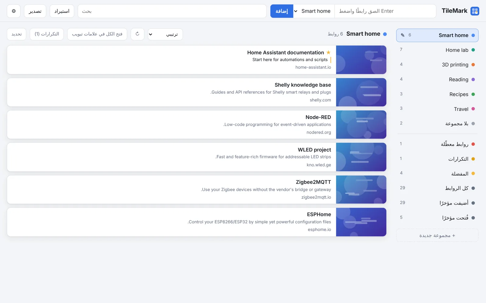

# Settings

Everything you can set in TileMark is in **⚙ Settings** (top right). Each section is a card: click its title to open it. Only one card is open at a time, and a closed card shows a short status, so you often don't need to open it at all.

Your own choices (layout, appearance, language, cards) are saved **with your account**, so every device you use looks the same. Admin cards are grouped at the bottom under **Installation (admin)**; other people don't see them.

**On this page:** [Layout](#layout) · [Appearance](#appearance) · [Cards](#cards) · [Your account](#your-account) · [Two-factor sign-in](#two-factor-sign-in) · [Signed-in devices](#signed-in-devices) · [Save from anywhere](#save-from-anywhere) · [Link check](#link-check) · [Backup and restore](#backup-and-restore) · [People](#people) · [Installation](#installation) · [Restore the whole installation](#restore-the-whole-installation) · [Home Assistant sensors](#home-assistant-sensors)

---

## Layout

| Option | What it does |
| --- | --- |
| **Side panel** | Groups in a column on the left; click one to list its links beside it. Good with many groups. |
| **Sections** | All groups on one page as collapsible sections with large picture cards. |

More in [Links and groups](links-and-groups.md#two-layouts).

## Appearance

| Option | What it does |
| --- | --- |
| **Follow my device / Light / Dark** | The colour scheme. *Follow my device* switches with your computer's or phone's dark mode. |
| **Language** | **Follow my browser** (the default), **English**, **Nederlands** or **العربية**. Arabic is shown right to left. The page reloads in the chosen language. |

## Cards

| Option | What it does |
| --- | --- |
| **Picture size** | **Small**, **Medium** or **Large** pictures on the cards. |
| **Clicking a link opens it** | **In a new tab** (the default) or **In this tab**. |
| **New links go to** | The group that new links go to when you aren't looking at a group. **No group** leaves them ungrouped. |

The keyboard shortcuts are listed here too: `/` search, `n` add a link, `Esc` clear the search or leave a field.

## Your account

| Option | What it does |
| --- | --- |
| **Username** | Your name for signing in. |
| **New password** | Leave empty to keep your current one. At least 8 characters. A new password signs out your other devices. |
| **Current password** | Needed to save any change. |
| **Save account** | Saves the changes above. |
| **Sign out** | Signs you out on this device. |

In the [Home Assistant add-on](home-assistant-add-on.md) you are signed in through Home Assistant; set a password here only if you also want to use TileMark's own address.

## Two-factor sign-in

Asks for a code from an authenticator app after your password. Shows **On** or **Off** in the card's title.

| Button | What it does |
| --- | --- |
| **Turn on** | Shows a QR code to scan with your authenticator app; confirm with one code. You then get ten recovery codes. |
| **New recovery codes** | Replaces your recovery codes. Asks for your password. |
| **Turn off** | Switches it off. Asks for your password. |

Step by step, and what to do when you lose your phone: [Accounts and security](accounts-and-security.md#two-factor-sign-in). Not shown in the Home Assistant sidebar.

## Signed-in devices

Lists every browser signed in to your account: browser and system, address, when it was last active and when it signed in.

| Button | What it does |
| --- | --- |
| **Sign out** | Signs that device out. |
| **Sign out all other devices** | Signs out every device except this one. |

## Save from anywhere

| Part | What it does |
| --- | --- |
| **🔖 Save to TileMark** | A button to **drag** to your browser's favorites bar. Click it on any page to save that page. |
| **Phone** | How to install TileMark as an app on your phone (needs HTTPS). |
| **Create API key** | Makes a key for scripts and Shortcuts. It is shown once. |
| **Replace API key** | Makes a new key; the old one stops working. |
| **Remove API key** | Switches the key off. |

Details and examples: [Save from anywhere](save-from-anywhere.md).

## Link check

| Part | What it does |
| --- | --- |
| Status line | When the last check ran, and how many of your links are broken. |
| **Check now** | Checks your links now, in the background. |
| **Refresh all titles and pictures** | Fetches the title and picture of all your links again. |

More in [Broken links](broken-links.md).

## Backup and restore

| Option | What it does |
| --- | --- |
| **Backup password** | Optional, but recommended: encrypts the backup file. Can't be recovered if forgotten. |
| **Download backup** | Downloads one file with all your links, groups and pictures. |
| **Restore: choose file** | The backup file to restore (`.tmk` or `.zip`; LinkBoard backups work too). |
| **Password of that backup** | Only if it has one. |
| **Restore from backup** | Replaces **all** your links and groups with those in the file, after you confirm. |

More in [Backups](backups.md).

---

## Installation (admin)

Only admins see these cards. They affect every account.

## People

| Part | What it does |
| --- | --- |
| The list | Everyone with an account, with their number of links, and whether they are admin or use two-factor sign-in. |
| **New password** | Sets a new password for that person and signs them out everywhere. |
| **Make admin / Remove admin** | Gives or takes admin rights. There is always at least one admin. |
| **Turn off 2FA** | Switches off their two-factor sign-in, for when they lost their phone. |
| **Remove** | Deletes the account with all its links, groups and pictures. Can't be undone. |
| **Add a person** | Username, first password (at least 8 characters) and **Also an admin**, then **Add person**. |

More in [Accounts and security](accounts-and-security.md#adding-people-admin).

## Installation

| Option | Default | What it does |
| --- | --- | --- |
| **Check everyone's links automatically once a week** | On | The weekly [link check](broken-links.md) for all accounts. |
| **Keep a daily backup of the whole installation** | On (off in the add-on) | Daily copies of everything in `data/backups`, the last 7 kept. The status line shows the last one. See [Backups](backups.md#daily-backups-of-the-whole-installation). |
| **Fetch titles and pictures for local network addresses** | Off | Lets TileMark visit addresses inside your network (`192.168.x.x`, `nas.local` …). Turn it on only if you trust everyone with an account. See [Local addresses](accounts-and-security.md#local-addresses). |

## Restore the whole installation

| Part | What it does |
| --- | --- |
| The list | The daily backups and the safety copies made before a restore, newest first. |
| **Download** | Downloads that backup. |
| **Restore** | Puts every account back to that day. Type the date to confirm; a safety copy of now is made first. |
| **Make a backup now** | Makes a backup straight away. |

More in [Backups](backups.md#restoring-the-whole-installation-admin).

## Home Assistant sensors

| Option | What it does |
| --- | --- |
| **Send to Home Assistant over MQTT** | Shows TileMark in Home Assistant as a device with sensors. On by default in the add-on. |
| **Device name in Home Assistant** | The device's name. Empty uses the default. |
| **Broker, Port, Username, Password** | Your MQTT broker. In the add-on, leave the broker empty to use Home Assistant's own. |
| **Encrypted connection (TLS)** | For brokers that use TLS. |
| **Discovery prefix** | Leave at `homeassistant` unless you changed it in Home Assistant. |
| **Save and connect** | Saves and connects. The status line shows the result. |
| **Device ID / New ID** | Gives this installation a new device in Home Assistant, for when two TileMarks share one ID. |

More in [Home Assistant sensors](home-assistant-sensors.md).

---

The version of TileMark you are running is shown at the bottom of Settings.
