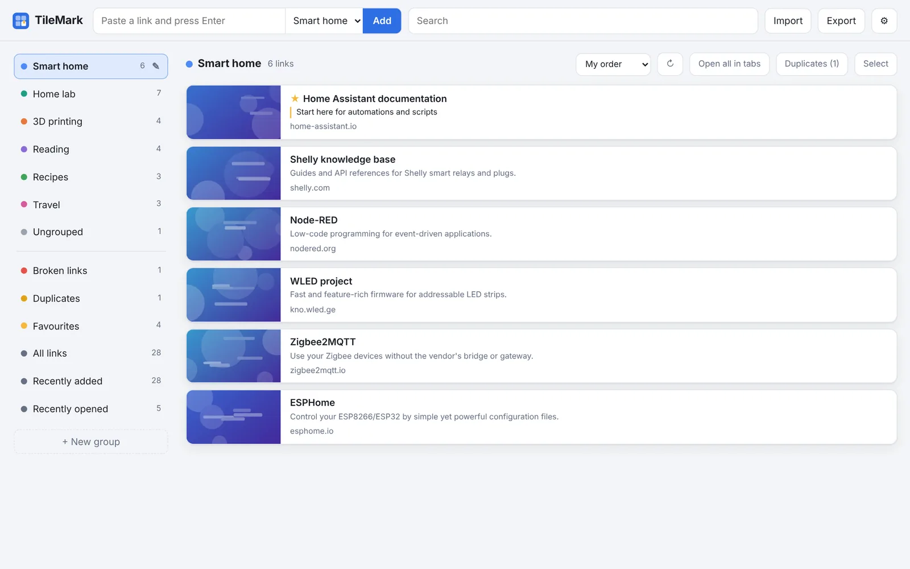
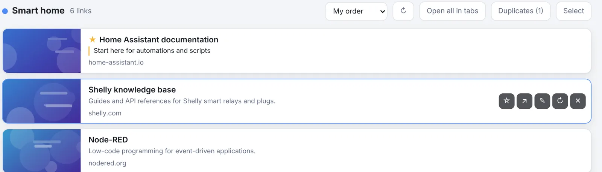
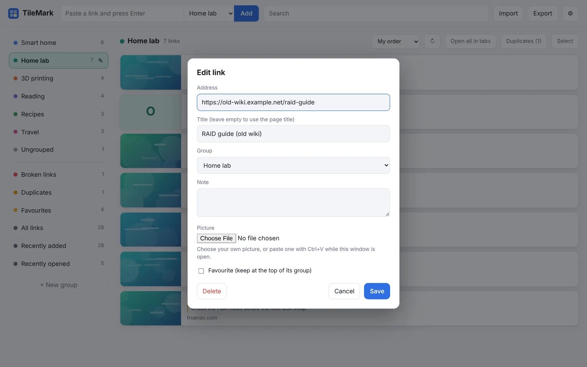
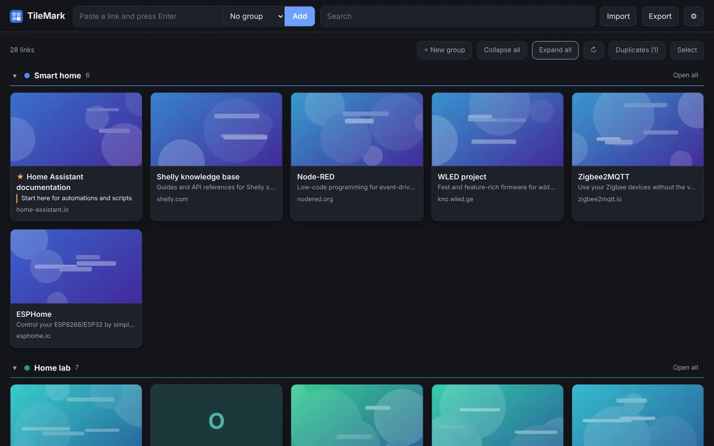
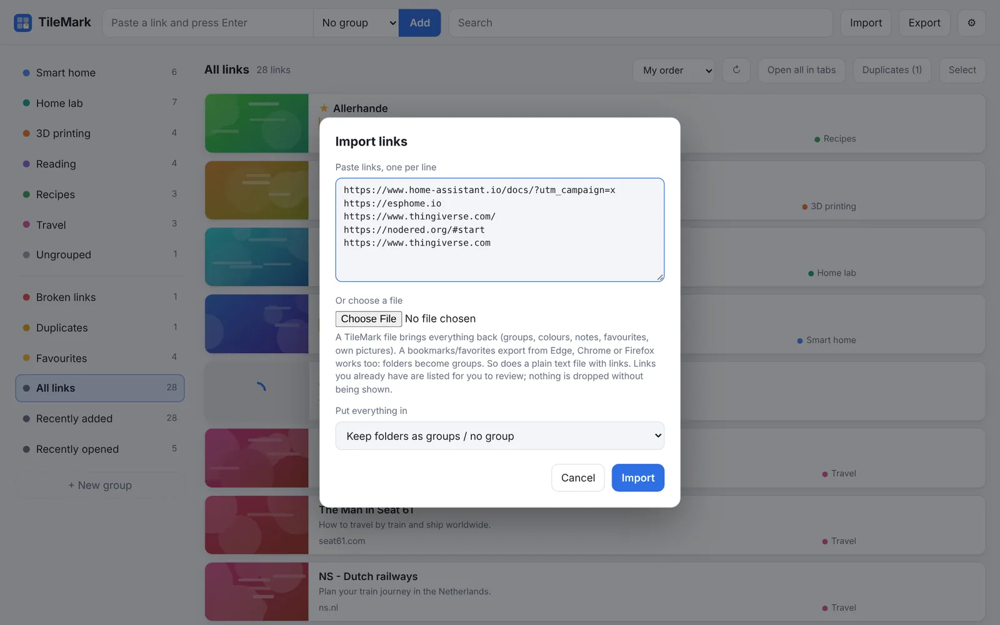
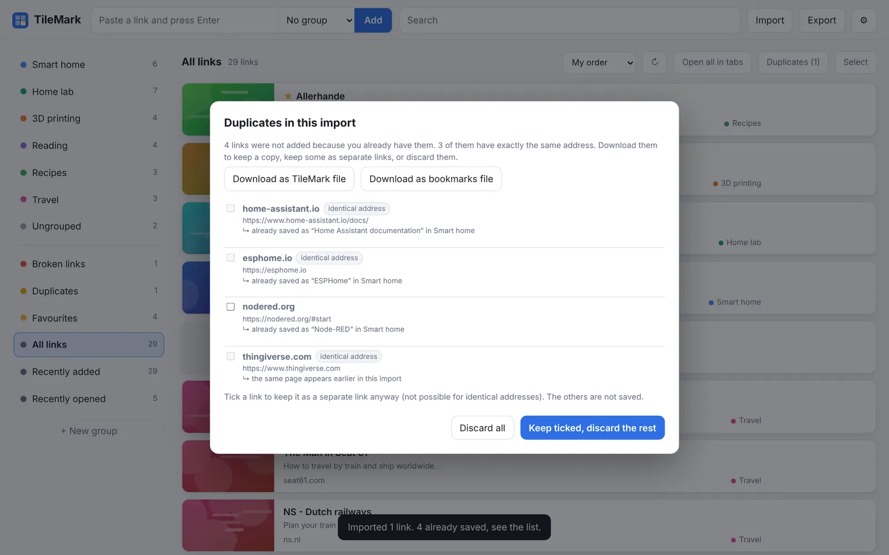
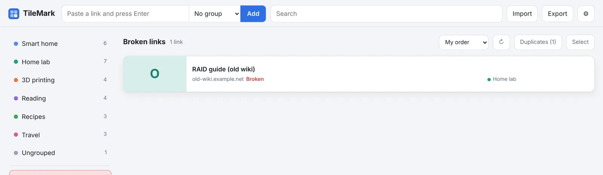
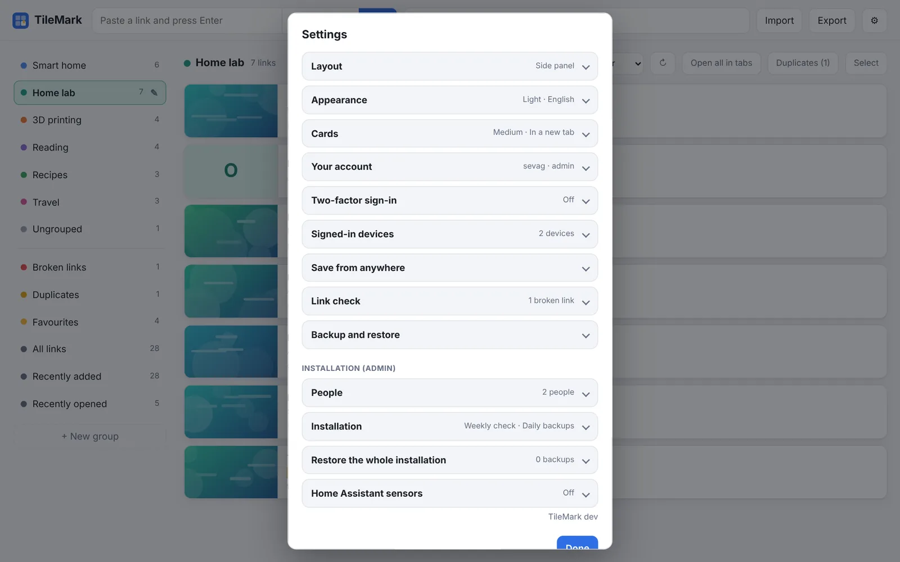
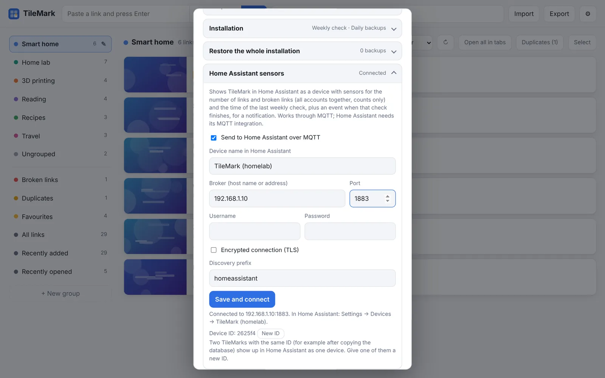

# TileMark

Your web links as picture tiles, in the Home Assistant sidebar. Save a link and TileMark adds its title, a short description and a picture. Put links in coloured groups, mark favourites, add notes, and let TileMark check every week which links stopped working.

Every Home Assistant user gets **their own private TileMark**, with no separate login.



The full guide, with every option explained, is on the website: <https://sevagjb.github.io/TileMark/>

---

## Getting started

1. On the **Info** tab, turn on **Show in sidebar** and press **Start**.
2. Open **TileMark** from the Home Assistant sidebar. Home Assistant has already signed you in; there is no setup code and no password.
3. Paste a web address into the field at the top and press **Enter**. The card appears at once and fills in with a title and picture a moment later.
4. Have bookmarks in your browser already? Use **Import** to bring them all in at once (see **Importing bookmarks** below).

The app has **no options** on the Configuration tab. Everything is set inside TileMark, under **⚙ Settings** (top right).

## Accounts

- Every Home Assistant user who opens TileMark gets **their own TileMark account**, with their own links, groups and settings. Nobody, the admin included, can see someone else's links.
- The **first person** to open TileMark becomes its admin, and so does every **Home Assistant administrator**. Admins see extra cards at the bottom of Settings (people, installation settings, sensors).
- Home Assistant's own sign-in, and its two-factor if you use it, protects the sidebar page. TileMark's own two-factor sign-in is only used on **TileMark's own address**.

## Saving links

Paste an address into the field at the top and press **Enter** (or **Add**). The list next to the field chooses the group.

- **Several links at once:** paste several lines; TileMark opens the import window with them filled in.
- **No `https://` needed:** it is added for you (`http://` for local addresses).
- **Tracking removed:** `utm_…`, `fbclid` and similar parameters are stripped before saving.
- **Already saved?** TileMark tells you where the link already is instead of saving it twice.

### The buttons on a card



Click a card to open the link. Point at a card (on a phone they are always shown) to see its buttons:

| Button | What it does |
| --- | --- |
| **☆ / ★** | Favourite: keeps the link at the top of its group and in **Favourites**. |
| **↗** | Share, or copy the address. |
| **✎** | Edit the link: address, title, group, note and your own picture. |
| **↻** | Fetch the title and picture again. |
| **✕** | Delete the link. |

### Editing a link



In the edit window you can give a link your own **title**, move it to another **group**, add a **note** (shown on the card and found by search), or use **your own picture**: choose an image file, or paste one with **Ctrl+V**.

## Groups

Groups are like folders, or like the tab groups in your browser: each has a **name** and a **colour**.

- **+ New group** in the left column makes one; **✎** next to a group renames it, changes its colour or deletes it (its links are kept, ungrouped).
- **Drag** a card onto a group to move it, drag groups to reorder them, and drag cards inside a group to put them in your own order.
- **Select** (top right) lets you tick several links and move, refresh or delete them together.
- **Open all in tabs** opens every link of a group at once.

Below your groups, TileMark keeps lists for you: **Ungrouped**, **Favourites**, **All links**, **Recently added**, **Recently opened**, and, when there are any, **Broken links** and **Duplicates**.

**Two layouts** (⚙ Settings → Layout): **Side panel** (shown at the top of this page) or **Sections**, all groups on one page with large picture cards:



**Keyboard shortcuts:** `/` search, `n` add a link, `Esc` clear the search or close a window.

## Importing bookmarks



Click **Import** in the top bar, then paste links (one per line) or choose a file:

- a **bookmarks / favorites export** from Edge, Chrome, Firefox, Brave or Safari (`.html`): each folder becomes a group;
- a **TileMark file** (`.json`, from **Export**), with groups, colours, notes, favourites and pictures;
- a **plain text file** with links.

| Browser | Export your bookmarks from |
| --- | --- |
| **Edge** | Favorites (Ctrl+Shift+O) → **⋯** → **Export favorites** |
| **Chrome / Brave** | Bookmark manager (Ctrl+Shift+O) → **⋮** → **Export bookmarks** |
| **Firefox** | **Manage bookmarks** (Ctrl+Shift+O) → **Import and Backup** → **Export Bookmarks to HTML** |
| **Safari** | **File** → **Export** → **Bookmarks** |

Titles and pictures are fetched in the background, so a big import fills in over a minute or two. **Export** takes everything out again, as a TileMark file or as a bookmarks file any browser can import.

## Duplicates

TileMark recognises when two addresses lead to the **same page**, even when they look a little different (`www.` or not, a slash at the end, tracking parameters, `youtu.be` versus `youtube.com`, a redirect).



Links you already have are **never added twice and never thrown away silently**. After an import, a window lists them so you can download a copy, keep some anyway, or discard them. For duplicates you already have, a **Duplicates** button appears in the toolbar to clean them up one set at a time.

## Broken links



**Once a week**, TileMark checks every link in the background. A link that no longer works gets a red **Broken** label and appears in **Broken links** in the left column. When a later check reaches it again, the label disappears by itself. Pages behind a sign-in and sites that are briefly down are not counted.

**⚙ Settings → Link check → Check now** checks your links straight away.

## Settings



Everything is in **⚙ Settings** (top right). Each section is a card: click its title to open it, and a closed card shows a short status. Your own choices are saved with your account, so all your devices look the same.

| Card | What you set there |
| --- | --- |
| **Layout** | Side panel or Sections. |
| **Appearance** | Light, dark or follow your device; language: English, Nederlands or العربية. |
| **Cards** | Picture size, open links in a new tab or this tab, the group new links go to. |
| **Your account** | Username and a password, needed only for **TileMark's own address**. |
| **Signed-in devices** | See and sign out the browsers signed in on TileMark's own address. |
| **Save from anywhere** | The browser button, the phone app and the API key. |
| **Link check** | Check now, and refresh all titles and pictures. |
| **Backup and restore** | Download a backup of your own links, or restore one. |
| **People** *(admin)* | Everyone with an account, their number of links, admin rights, remove an account. |
| **Installation** *(admin)* | The weekly link check, TileMark's own daily backup, fetching local addresses. |
| **Restore the whole installation** *(admin)* | TileMark's own daily backups: encrypt them, download, restore, make one now. |
| **Home Assistant sensors** *(admin)* | The MQTT device; see **Sensors and notifications** below. |

The version you are running is shown at the bottom of Settings.

## Backups

Everything TileMark stores is in the app's data folder, so **Home Assistant backups include TileMark**. The app pauses for a moment while Home Assistant makes a backup, so the copy is always consistent.

- TileMark's own **daily backup** is **off** in the app, because Home Assistant already covers it (and Home Assistant can encrypt its own backups). An admin can switch it on in **⚙ Settings → Installation** to have both, and encrypt it under **Restore the whole installation**.
- Each person can always **download a backup of their own links** in **⚙ Settings → Backup and restore**. It is encrypted with their TileMark password; accounts made by Home Assistant have none until one is set in **Your account**, so until then use **More options → A different password** (it can't be recovered if forgotten).

## Sensors and notifications

If Home Assistant has an MQTT broker (for example the **Mosquitto broker** app with the **MQTT** integration), TileMark shows up by itself as a device called **TileMark (Home Assistant)**. No setup is needed: the app uses Home Assistant's own broker.

| Entity | Shows |
| --- | --- |
| **Links** | The number of links, all accounts together. |
| **Broken links** | How many links the last check couldn't reach. |
| **Last link check** | When the weekly check last ran. |
| **Link check** (event) | Fires when the weekly check finishes, with `checked`, `broken` and `new_broken`. |

Only **numbers** are sent; nobody's links or addresses leave TileMark. The device page also has a **Visit** link that opens TileMark in the sidebar.



An admin can check the connection, change the device name, use another broker or turn it off in **⚙ Settings → Home Assistant sensors**.

**A phone notification when links break** (replace the entity with your TileMark's **Link check** entity, and the action with your phone):

```yaml
alias: TileMark broken links
triggers:
  - trigger: state
    entity_id: event.tilemark_home_assistant_link_check
conditions:
  - condition: template
    value_template: "{{ trigger.to_state.attributes.new_broken | int(0) > 0 }}"
actions:
  - action: notify.mobile_app_your_phone
    data:
      title: TileMark
      message: >-
        Found {{ trigger.to_state.attributes.new_broken }} new broken links
        ({{ trigger.to_state.attributes.broken }} in total).
```

**Two TileMarks showing as one device?** That happens when one was made from the other's database or backup. Press **New ID** in **⚙ Settings → Home Assistant sensors** on one of them, then give each a clear device name.

## TileMark's own address (optional)

Inside the sidebar the address changes every session. Three features need a fixed address: the **browser button** (save the page you are on with one click), the **phone app** (install TileMark and share links to it from other apps) and the **API key** (for scripts and iPhone Shortcuts). To use them:

1. On this app's **Configuration** tab, under **Network**, enter a port for TileMark (for example `8080`), save, and restart the app.
2. In TileMark (from the sidebar), open **⚙ Settings → Your account** and **set a password**. Accounts made through Home Assistant have none until you set one.
3. Open `http://<your-home-assistant>:<port>` and sign in with your TileMark username and that password.
4. Set up the browser button, the phone app or the API key from **⚙ Settings → Save from anywhere** on that page.

Leave the port empty if you only use the sidebar; TileMark can then only be reached through Home Assistant. For the **phone app** the address must be **HTTPS**, for example through a reverse proxy. Step by step: <https://sevagjb.github.io/TileMark/save-from-anywhere.html>

## Moving from Docker

1. In your Docker TileMark, each person downloads a backup: **⚙ Settings → Backup and restore → Download backup**.
2. In Home Assistant, each person opens TileMark from the sidebar once (this creates their account) and restores their file in the same section.

If you keep both running, see *Two TileMarks showing as one device* under **Sensors**.

## Updating

Home Assistant shows an update for TileMark like for any app; the **Changelog** tab shows what changed. If a new version doesn't appear yet, open **Settings → Apps → App store → ⋮ → Check for updates**.

## Troubleshooting

- **No title or picture for a link.** Sites that need a sign-in (Instagram, for example) often have none; use **✎** to add your own picture. For pages inside your network (`192.168.x.x`, `homeassistant.local` …) TileMark doesn't fetch anything unless an admin allows it in **⚙ Settings → Installation**. Local links can always be saved.
- **TileMark is not in the sidebar.** Turn on **Show in sidebar** on the Info tab, and check that the app is started.
- **The direct address asks for a password I don't have.** Set one first in **⚙ Settings → Your account**, from the sidebar.
- **No device in Home Assistant.** Check that the MQTT integration is set up, and that **⚙ Settings → Home Assistant sensors** says **Connected**.
- **Something else?** Look at the app's **Log** tab, and the questions on the website: <https://sevagjb.github.io/TileMark/faq.html>

## Support

Questions and bug reports: <https://github.com/sevagjb/tilemark/issues>

## License

TileMark is free and open source, under the MIT License: <https://github.com/sevagjb/tilemark/blob/main/LICENSE>
