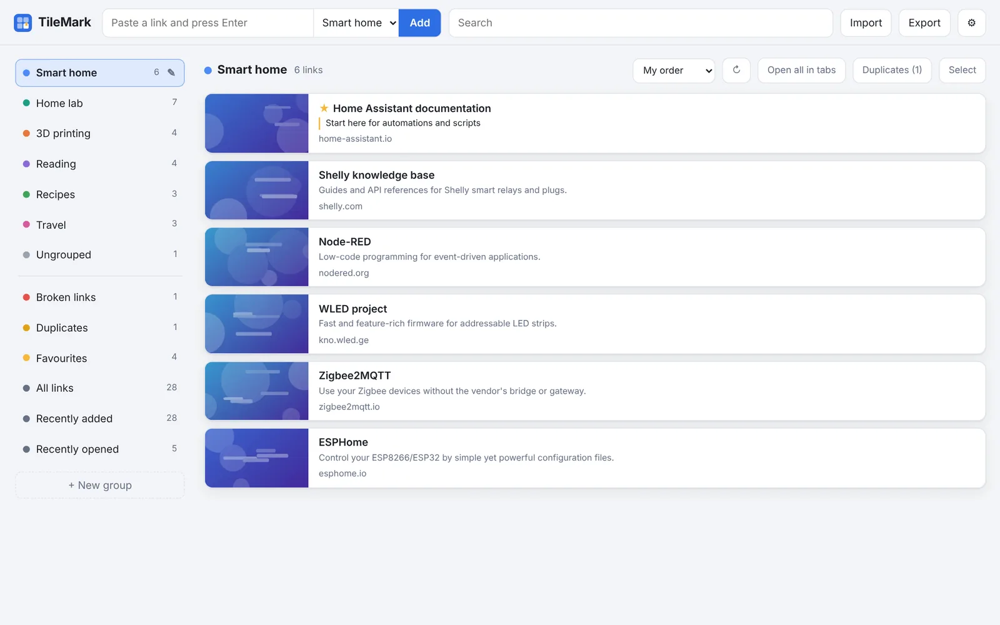

# TileMark add-on

Your web links as picture tiles, in the Home Assistant sidebar. Coloured groups, favourites, notes, duplicate detection, a weekly broken-link check, and sensors for your dashboards. Every Home Assistant user gets their own private TileMark; no separate login.

- **Save a link** and TileMark adds its title, description and picture.
- **Import** your browser bookmarks in one go; folders become groups.
- **Two layouts**, light and dark, in English, Nederlands and العربية.
- **Home Assistant backups** include TileMark; each person can also download their own backup.
- **MQTT sensors** for the number of links and broken links, and an event for notifications.

After installing, the **Documentation** tab explains everything step by step, with screenshots. The full guide is also on the website: <https://sevagjb.github.io/TileMark/>
